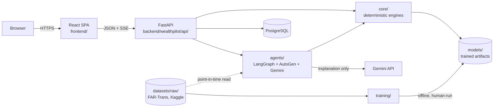
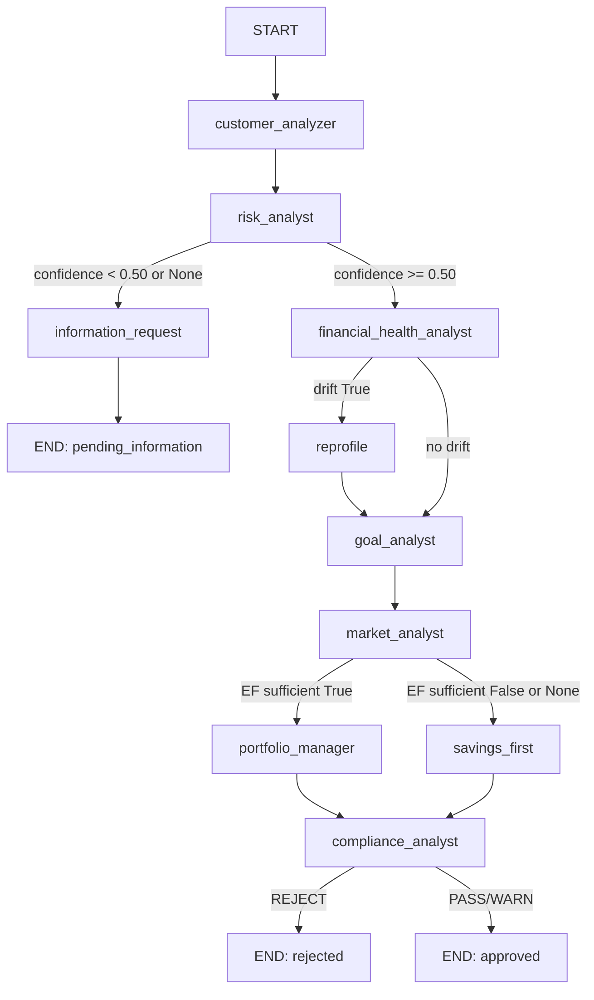

# WealthPilot AI — Architecture

Describes the system as actually implemented and verified, not as
originally planned. Where a component exists but is not live-wired into
the request path, that is stated explicitly. See `docs/MEMORY.md` for
current status and `docs/DECISIONS.md` for why each choice was made.

## 1. System Overview



Two runtime halves: a Python backend that owns every financial number,
and a React frontend that only displays what the backend returns.
Training is a separate, offline, human-triggered step that never runs
inside a request.

## 2. Repository Structure

```text
backend/
  pyproject.toml
  wealthpilot/
    config/      settings (pydantic-settings), logging
    db/          models, session, migrations glue
    data/        acquisition, quality, preprocessing -- CODE only, no data
    core/        goal math, optimizer, compliance -- deterministic, DB-free
    agents/      state, nodes, graph, debate, explanation, recommendation
    api/         routers, schemas, dependencies, sse, services
  alembic/       migration scripts
training/        one script per model family (risk/expense/behaviour/market/portfolio)
models/          serialized artifacts + metrics.json (risk/expense/behaviour/market/portfolio)
datasets/raw/    downloaded data, gitignored -- .gitkeep tracked
  FAR-Trans/     customer_information, asset_information, markets, close_prices,
                 limit_prices, transactions, questionnaires (.csv)
  kaggle/        personal-finance-ml-dataset
config/
  compliance_rules.yaml
tests/           mirrors backend/ + training/ structure
frontend/
  src/
    components/ui/       shadcn primitives -- added via CLI
    components/charts/    display-only Recharts components + agent pipeline view (Phase 30)
    components/<feature>/ page-support components (portfolio/, profile/, shell/)
    pages/                one file per route
    lib/                  api-client.ts (typed fetch), format.ts, demo-customer.ts
    types/api.ts          GENERATED -- never hand-edited
    hooks/                one TanStack Query hook per resource
    providers/            auth-context, customer-context, theme-provider
docs/            this document and its siblings
reports/         phase-by-phase completion reports (historical record)
scripts/         shell wrappers + seed_demo_data.py
demo_data/       synthetic demo dataset (personas, household, scenarios, expected
                 outcomes, manifest) -- seed input only, never ML training data (ADR-038)
```

`training/`, `models/`, `datasets/`, `config/`, and `tests/` are
top-level, siblings of `backend/` and `frontend/` — not nested inside
`backend/`. `PYTHONPATH` must include the repo root (not just `backend/`)
for `training.*` imports to resolve outside of pytest's own
`pythonpath = .` (`pytest.ini`) — see `Makefile`'s `dev-backend` target
for the documented reason this surfaced as a real bug once.

## 3. Technology Stack

Backend: Python 3.11, FastAPI, uvicorn, SQLAlchemy, Alembic, PostgreSQL,
LangGraph, AutoGen, google-genai, scikit-learn, XGBoost, TensorFlow,
statsmodels, arch, yfinance, SHAP, pandas, numpy, scipy, Pydantic v2,
pydantic-settings.

Frontend: React 19, Vite, TypeScript, Tailwind CSS, shadcn/ui, TanStack
Query, React Router, Recharts, lucide-react.

No Docker, no Next.js — both halves run natively. Full rationale for each
choice: `docs/DECISIONS.md`.

## 4. Frontend Architecture

`main.tsx` composes providers: `ThemeProvider > QueryClientProvider >
AuthProvider > CustomerProvider > TooltipProvider > BrowserRouter > App`.
`App.tsx` defines routes: `/login` and `/create-user` are public;
everything else is wrapped in `ProtectedRoute` (redirects to `/login`
when unauthenticated); `/onboarding/questionnaire` and
`/onboarding/goals` sit inside the auth guard but outside `AppShell`
(standalone, no sidebar); every other protected route renders inside
`AppShell` (sidebar + header).

Ten pages read live analysis/profile data: Dashboard, Customer Profile,
Risk Assessment, Financial Health, Goals, Portfolio, Recommendation, Why
This Recommendation, Agent Activity, Scenario Simulator. Every one reads
`profileId` from `useCustomer()` (never local/independent state) and
fetches through a shared TanStack Query hook keyed by that id, so every
page showing a given customer shows the exact same cached result — see
`docs/DECISIONS.md` ADR-021. The Recommendation page renders the API's
`compliance.rule_results` through the display-only
`components/shell/compliance-breakdown.tsx` (Phase 29 — before that, no
page rendered rule-level compliance reasons, so a rejected analysis could
show only a generic "blocked" sentence).

Household section (Phase 32): the Customer Profile page renders
`components/profile/household-card.tsx` — the customer's household name, own
role and relationship, and member count as `GET /api/profiles/{id}/household`
returns them, plus (behind "View Household") the member table and, for the
primary member only, an add/remove-member form. It never creates a household
implicitly; the calling customer's id travels in `X-Customer-Id`
(`lib/api-client.ts`), and the single `useCustomer().profileId` remains the
active user — membership never switches customers.

Household financial summary (Phase 34): above those tabs, the expanded card
renders `components/profile/household-financial-summary.tsx` over
`hooks/use-household-summary.ts` — the household's recurring monthly view,
one-time records, assets/liabilities table, net position, emergency-fund
position and a plain "what is recorded" list. It is display-only: **every
figure arrives already computed** from `GET /api/households/{id}/
financial-summary`, and the component performs no arithmetic whatsoever, shows
no score, ranking or recommendation, and renders `null` as "Not provided"
rather than 0 (ADR-033).

Household financial records (Phase 33): the same card gained four tabs beside
Members — Income, Expenses, Assets, Liabilities — rendered by the
config-driven `components/profile/household-finance-section.tsx` over
`hooks/use-household-finances.ts`. Each tab lists the household's stored
records exactly as the API returned them, with add/edit/delete dialogs for the
primary member and read-only tables for everyone else. The component performs
**no arithmetic of any kind**: it formats, validates form shape and manages
dialog state, renders a `null` as "Not provided" (never `0`), and displays no
total, net worth, savings rate or ratio (`docs/DECISIONS.md` ADR-032).

Analytics layer (Phase 30): `components/charts/` holds the Recharts
components (`RiskProbabilityChart`, `EmergencyFundChart`, `GoalTargetChart`,
`PortfolioAllocationChart`, `ScenarioComparisonChart`) and `AgentPipeline`.
They are purely presentational: typed props in, no API call, no financial
logic, `null` rendered as an unavailable state. The pages pass them fields
from the same shared `AnalysisResult` query, so a chart can never show a
number the page's own text does not. No backend endpoint was added for
charts. Per-chart field mapping and rules: `docs/DESIGN.md` section 16;
decision: `docs/DECISIONS.md` ADR-029.

State layers, deliberately separate:

- `AuthProvider` (`isAuthenticated`, `login`, `logout`) —
  `wealthpilot-prototype-authenticated` in `localStorage`.
- `CustomerProvider` (`profileId`, `setProfileId`) —
  `wealthpilot-profile-id`. The single source of truth for "which
  customer is this session showing."
- `lib/demo-customer.ts` — a third, independent
  `wealthpilot-demo-customer-id` key tracking "which real customer IS the
  canonical demo persona," a stable cross-session fact, not
  session-scoped (not cleared on logout).

## 5. Backend Architecture

```text
POST /api/analysis  (api/routers/analysis.py)
  -> api/services/analysis_service.py::get_or_run_analysis
       -> compute_profile_hash (cache key: customer/goal/financial-input
          content + explicit strategy override + ANALYSIS_PIPELINE_VERSION,
          so a change to what the pipeline COMPUTES invalidates stale
          cached results)
       -> cached AnalysisRun? return it
       -> else: PipelineRun(session, customer_id, portfolio_strategy).events()
            -> _build_graph_dependencies  (Phase 28: financial_inputs -> GraphDependencies)
            -> agents/graph.py::build_analysis_graph().stream(...)
            -> if overall_status == "approved":
                 agents/recommendation.py::recommendation_engine_node
                 agents/explanation.py::explanation_node
       -> persist AgentLog rows, RiskAssessment row, AnalysisRun.result
```

`GET /api/analysis/stream` (`api/sse.py`) drains the SAME
`PipelineRun.events()` generator, forwarding each `NodeEvent` as an SSE
frame — one execution path backs both endpoints, never two that could
drift apart. `NodeEvent` carries only `node`/`status`/`duration_ms`/
`summary`/`model_version` — no field exists for a prompt, reasoning
trace, or transcript, so none can leak by construction.

## 6. API Architecture

Routers: `profiles.py` (questionnaire, profile CRUD, goals, financial
inputs, name lookup), `analysis.py` (`POST`/`GET /api/analysis`),
`scenarios.py` (`POST /api/scenarios/compare` — re-runs
`get_or_run_analysis` with a different `portfolio_strategy`, never a new
calculation), `qa.py`, `health.py`, and — Phase 32 — `households.py` (`POST
/api/households`, `GET /api/households/{id}`, `GET`/`POST
/api/households/{id}/members`, `DELETE /api/households/{id}/members/{member_id}`,
`GET /api/profiles/{id}/household`; there is deliberately no household-deletion
route) and — Phase 33 — `household_finances.py`, which adds a uniform
list/create/update/delete set under each household for `income`, `expenses`,
`assets` and `liabilities` (16 routes, `api/services/
household_finance_service.py`) — those routes store and return records and
compute nothing (`docs/DECISIONS.md` ADR-032). Phase 34 adds exactly one
read-only calculation route, in its own module: `GET /api/households/{id}/
financial-summary` (`routers/household_summary.py` ->
`api/services/household_summary_service.py` -> `core/household_finance.py`).
There is still no totals, net-worth, savings or debt-ratio route, no mutation
route for calculations, and nothing derived is ever persisted — a summary is
recomputed from the source records on every request (ADR-033). Household routes are the first routes
that require the caller's associated customer (`X-Customer-Id`,
`api/dependencies.py::get_acting_customer_id`) and authorize against household
membership (`api/services/household_service.py`); a customer can read only
their own household, only the primary can add/remove members or mutate a
financial record, and a record id belonging to another household is a 404
rather than a 403. That identity is
asserted by the client (there is no server session), so it stops accidental and
URL-edited cross-household access, not a malicious client (`docs/SECURITY.md`).
Every response schema is a dedicated
`api/schemas.py` Pydantic model, never a re-export of an internal
`agents/state.py` model. Errors: RFC 7807 problem+json
(`api/errors.py`).

## 7. Database Architecture

```mermaid
erDiagram
    customers ||--o{ financial_goals : has
    customers ||--o{ questionnaire_answers : has
    customers ||--o| financial_inputs : has
    customers ||--o| household_members : belongs_via
    households ||--|{ household_members : has
    households ||--o{ household_incomes : records
    households ||--o{ household_expenses : records
    households ||--o{ household_assets : records
    households ||--o{ household_liabilities : records
    customers ||--o{ transactions : has
    customers ||--o{ portfolios : has
    customers ||--o{ recommendations : has
    customers ||--o{ agent_logs : has
    customers ||--o{ risk_assessments : has
    customers ||--o{ analysis_runs : has
    customers ||--o{ customer_risk_snapshots : has
```



`customers.risk_inputs` (JSON) holds `external_customer_id`, the mapping
from a DB customer to a raw FAR-Trans `customerID` — set only by
`data/ingestion.py` (real population) or one direct SQL write in
`scripts/seed_demo_data.py` (demo personas); no public schema exposes it.
`market_data` and `transactions` are populated from FAR-Trans/yfinance,
never mutated by the live API. `financial_inputs` (Phase 28) is the one
table with every column independently nullable by design — see
`docs/DECISIONS.md` ADR-025.

`households` and `household_members` (Phase 32, migration `f59ab6395383`)
add the household foundation: `Customer -> Household Membership -> Household`.
The existing `customers` table is untouched — a membership row only
references it. `household_members` carries `relationship` (self / spouse /
parent / child / sibling / other), `role` (primary / member / dependent) and
`is_dependent` (always exactly `role = 'dependent'`), and the database itself
enforces the rules: `UNIQUE(customer_id)` (one household per customer, which
also makes a duplicate within a household impossible), a partial unique index
(one primary per household), and CHECK constraints (controlled vocabularies;
primary implies `self`; `self` is never a dependent). "At least one primary" is
guaranteed transactionally: the primary is created in the same transaction as
its household and no API path removes it. Both foreign keys cascade. **Neither
table has a financial column, and household membership is contextual only — it
never feeds `POST /api/analysis`** (`docs/DECISIONS.md` ADR-031).

`household_incomes`, `household_expenses`, `household_assets` and
`household_liabilities` (Phase 33, migration `d2be70d8b07f`) hold the
household's own financial records. Each is owned by a household through an
indexed, cascading `household_id` and carries **no `customer_id`** — a record
belongs to the household, not to the member who entered it. Amounts are
`Numeric(14, 2)` like every other money column in the schema, and CHECK
constraints enforce the controlled vocabularies (frequency; expense category;
asset type; liability type — income `source` is free text by design) together
with the sign rules: income and expense `amount > 0`, `current_value >= 0`,
`outstanding_amount >= 0`, and `monthly_payment IS NULL OR monthly_payment >= 0`.
`monthly_payment` is nullable because "not provided" is not "no payment", and
an expense's `is_essential` has no default because it is the household's own
judgement. **No column, table or view aggregates any of it, and the individual
analysis pipeline never reads these tables** (`docs/DECISIONS.md` ADR-032/033,
`docs/RULES.md` Rule 32/33). Phase 34 added **no table, column or migration**:
its summary is derived in Python, per request, from these same rows.

Phase 35 (migration `a7c41e9b6f30`) added seven **optional factual metadata**
columns to those same four tables — `notes` on each, `description` on assets
and liabilities, and `interest_rate` (`Numeric(6, 4)`, CHECK `>= 0`) on
liabilities — all nullable with no default, so existing rows were preserved
untouched. No table was created and no existing column or constraint changed.
The metadata is never read by `core/household_finance.py`, whose input records
have no field for it (ADR-034).

`household_goals` (Phase 36, migration `c3e8f2a9d154`) holds a household's
goals — `name`, a controlled `goal_type`, `target_amount` (> 0), a nullable
`current_savings`, `target_date`, `notes`, `is_active` — owned through an
indexed, cascading `household_id` and with no `customer_id`. It is entirely
separate from the individual `financial_goals`. It stores facts only; no goal
math is computed for it, because `core/goals.py` needs assumptions no household
has (ADR-035). Served by `routers/household_goals.py` ->
`api/services/household_goal_service.py`, which reuses Phase 33's
ownership-scoped helpers and authorization unchanged.

Migrations: `backend/alembic/`, applied via `alembic upgrade head`
(dev, `DATABASE_URL`) or `ALEMBIC_TARGET=test alembic upgrade head`
(test, `TEST_DATABASE_URL`) — the URL always comes from
`wealthpilot.config.get_settings()`, never a stale `alembic.ini` value.

## 8. ML Architecture

| Family | Training | Artifact | Serves |
|---|---|---|---|
| Risk | `training/risk/` | `models/risk/{preprocessor,rf}_v1.pkl` | `agents/nodes.py::risk_analyst_node` |
| Behaviour | `training/behaviour/` | `models/behaviour/iforest_v1.pkl` | `agents/nodes.py::financial_health_node` (drift/anomaly only) |
| Expense | `training/expense/` | `models/expense/*.pkl` | Kaggle-population clustering — never applied to a FAR-Trans customer |
| Market | `training/market/` | `models/market/*` + `metrics.json` | `agents/nodes.py::market_analyst_node` (reads `metrics.json` only, never retrains) |
| Portfolio | `training/portfolio/` (offline evaluation/backtest helpers) | n/a (optimizer itself is a pure `core/optimizer.py` function, not a trained artifact) | `agents/nodes.py::portfolio_manager_node` |

All artifacts loaded once at startup (`api/lifespan.py::warm_model_caches`)
and cached in-process (`@lru_cache`-decorated loaders in `agents/nodes.py`).

## 9. Data Pipeline

`data/preprocessing.py::load_far_trans_tables` reads the six FAR-Trans
CSVs under `datasets/raw/FAR-Trans/`, filters `Predicted_*`/
`Not_Available` risk labels, and hands off to `engineer_features()`
(Phase 3) — the SAME function both offline training and
`agents/nodes.py::engineer_features_for_customer` (live, single-customer,
provably equivalent to filtering the population output) call. The
database `transactions` table is populated once by `data/ingestion.py`
for the real FAR-Trans population and is NOT read by the live risk/
behaviour pipeline — confirmed by inspection: `Transaction` (the
SQLAlchemy model) is imported nowhere else in `wealthpilot/`.

## 10. LangGraph Architecture



Any unexpected node exception routes immediately to `END: failed` instead
of continuing. Full topology and every routing decision's rationale:
`reports/phase11_langgraph_report.md`; the two Phase-28 corrections
(savings-first no longer errors on unknown EF; compliance recognizes it
as valid) are in `docs/DECISIONS.md` ADR-018 and
`reports/phase28_financial_input_savings_first_report.md`.

## 11. AutoGen Architecture

`agents/debate.py` — three bounded personas critique an already-computed
allocation. Standalone (not compiled into the LangGraph graph itself, by
Phase 12's own documented design choice); called by later orchestration
where the design calls for it. Never a source of a number — see
`docs/DECISIONS.md` ADR-012.

## 12. Gemini Architecture

`agents/explanation.py::explanation_node` — invoked only when
`overall_status == "approved"`. Sends a fully-computed dict; validates
the structured response against it; falls back to a templated,
non-generative restatement (`validation_passed: false`) on any mismatch,
timeout, or API failure — never a raw exception, never a fabricated
number. `GEMINI_API_KEY`/`GEMINI_PROJECT_NUMBER`/`GEMINI_MODEL` are
backend-only settings, never sent to the frontend.

**Three roles** (ADR-037): the backend computes every number and decision;
Gemini only words them — its prompt asks for plain language a reader with no
financial background can follow, with every original safety rule kept, and its
output must pass the numeric checks (every figure traceable to the source; a
percentage beside a ticker must be that ticker's weight; no value converted into
a derived count such as "94 out of 100"; no guarantee language); the frontend
presents. Because explanations are cached with their analysis, the page's
default **Simple** view is built from the deterministic fields themselves
(`components/explanation/plain-language-explanation.tsx`), so it works for every
analysis, while the AI or fallback wording stays in the **Detailed** view.

## 13. Recommendation Architecture

`agents/recommendation.py` (orchestration) + `core/recommendation.py`
(pure decision logic) — precedence Compliance > Savings-first > Risk >
Goal > Market (`docs/DECISIONS.md` ADR-016). Reuses
`agents/nodes.py::portfolio_manager_node` directly when the
risk-conditioned strategy differs from whatever `state.portfolio_result`
already holds — never a second, parallel optimizer call path.

## 14. Compliance Architecture

`core/compliance.py::evaluate_compliance` against
`config/compliance_rules.yaml` (5 rules: `weights_sum_to_one`,
`no_negative_weights`, `qqq_within_risk_band`, `single_asset_cap`,
`emergency_fund_savings_first`). Fail-closed on missing data; `PASS` |
`WARN` | `REJECT`; REJECT wins unconditionally. `enforce_gate` is the
only sanctioned way past a computed result — see `docs/DECISIONS.md`
ADR-015/ADR-018.

## 15. Goal Architecture

`core/goals.py` — pure, DB-free TVM + Monte Carlo + emergency-fund
module. `GoalAssumptions` (contribution/return/inflation — no defaults
except `contribution_periods_per_year=12`) and
`monthly_essential_expenses`/`current_liquid_assets` are supplied by the
caller (`agents/nodes.py::goal_analyst_node`'s explicit parameters,
sourced by `analysis_service.py::_build_graph_dependencies` from the
Phase 28 `financial_inputs` table) — this module never reads the
database itself. `historical_returns` (Monte Carlo's bootstrap source)
must be **per-period** returns at the same `contribution_periods_per_year`
as `GoalAssumptions`: the equal-weighted daily `market_data` blend is
compounded into non-overlapping `round(252 / periods_per_year)`-day
blocks by `analysis_service.py::_compound_to_period_returns` before it
reaches the engine (Phase 29 fix, `docs/DECISIONS.md` ADR-027); it is
only built at all when `GoalAssumptions` exist.

## 16. Portfolio Architecture

`core/optimizer.py` — MVO (box-constrained max-Sharpe), HRP, 1/N;
Ledoit-Wolf covariance shrinkage (`scikit-learn.covariance`); risk-level
→ QQQ-band mapping; 70% general single-asset cap. Reads live
`market_data` via `agents/nodes.py::load_portfolio_returns` (public as of
Phase 28, reused for Monte Carlo's historical-returns input too — see
`docs/DECISIONS.md` ADR-004/ADR-017 area and Rule 4 in `docs/RULES.md`).

## 17. Authentication Architecture

Prototype only — see `docs/DECISIONS.md` ADR-020 and `docs/SECURITY.md`.
`login-form.tsx`'s `completeLogin` and `create-user-page.tsx`'s
`handleContinue` are the only two places that establish a session's
customer association; `header.tsx`'s sign-out clears both auth and
customer state.

## 18. Demo Architecture

`backend/scripts/seed_demo_data.py` — idempotent `setup`/`verify`/`reset`
against the real public API (plus the one documented direct-SQL write
for `external_customer_id`), plus `setup-family`/`verify-family`/
`reset-family` for the canonical family household (ADR-036).
`frontend/src/lib/demo-customer.ts` resolves the individual demo
("Use Individual Demo") to the seeded "Complete" persona by name (via
`GET /api/profiles/lookup`) whenever it exists — even if the browser had
remembered the blank fallback customer (Phase 31, ADR-030) — and only
otherwise to a remembered demo id or a from-scratch-creatable canonical
customer. See
`docs/DECISIONS.md` ADR-022 and `reports/demo_dataset_catalog.md` for the
current, live-verified persona matrix.

**Demo dataset (ADR-038).** `demo_data/` is the single source of the demo
population: four personas, the family household, scenario inputs and the
expected contract-level outcomes. Each file wraps exactly one API request
payload, and nothing computed is stored in it.

- `backend/scripts/demo_data_package.py` loads it for the seed; it has no
  database access and calculates nothing.
- `backend/scripts/validate_demo_data.py` validates it statically, including
  the manifest and a SHA-256 guard over `datasets/raw/`.

The flow is `demo_data/*.json` → the loader → `seed_demo_data.py` → the public
API, the same routes, schemas and services as any client → PostgreSQL. The
application then computes every result. Nothing under `backend/wealthpilot/`
or `training/` reads `demo_data/`, and the validator fails if anything does.

## 19. Error Handling

Backend: RFC 7807 problem+json for every 4xx/5xx; `_safe_call` in
`agents/graph.py` converts any node exception into a structured
`processing_failure` rather than crashing the process or continuing
silently. Frontend: `ApiClientError` (backend responded, non-2xx) vs
`ApiUnreachableError` (network/backend-down) are distinct types so a page
can show "service unavailable" vs a specific validation message;
`ErrorBoundary` wraps the whole app for uncaught render errors.

## 20. Data Flow

Onboarding: Create Profile → Questionnaire → Goals → (Phase 28) Financial
Inputs (on the Customer Profile page, not a separate onboarding step) →
Dashboard. Analysis: any of the ten protected pages triggers
`useAnalysisQuery(profileId)` (`POST /api/analysis`, cached server-side
by profile hash, client-side by TanStack Query) — the same cached result
backs every page showing that customer.

## 21. Security Boundaries

See `docs/SECURITY.md` for the full treatment. Summary: secrets only in
`.env` (gitignored); no server-side session (prototype auth, disclosed);
customer data isolated by id at the query level (not by authorization —
disclosed); no chain-of-thought/prompt ever reaches the frontend by
construction (the SSE/`NodeEvent` shape has no field for it).

## 22. Numerical Authority

Every number's single source: `core/*.py` (deterministic) or a
`models/<family>/` artifact (trained). React formats; Gemini restates in
prose; nothing else computes. See `docs/DECISIONS.md` ADR-014.

## 23. Current Known Limitations

- `expense_persona` is permanently `unavailable` for every FAR-Trans
  -linked customer (structural — see ADR-010), not a bug.
- Prototype authentication has no server session/token; `localStorage`
  is devtools-editable (disclosed, ADR-020).
- No customer-switching UI exists; a preserved demo persona other than
  the one currently resolved is only inspectable via `/docs`
  (ADR-021).
- No browser-based visual/interactive frontend testing has been possible
  in the development environment this project has been built in to date
  — verification has relied on `tsc`/`oxlint`/`vite build` plus
  source-level review; disclosed in every phase report where it applies.
- Goal feasibility is a real Monte Carlo result at the supplied
  assumptions and may legitimately be "At Risk" or "Not Feasible" (e.g. a
  short deadline against a much larger required contribution). Note the
  history: from Phase 28 until Phase 29, every goal showed a spurious
  0.0% / "Not Feasible" because the daily return series was applied once
  per monthly period (see `docs/DECISIONS.md` ADR-027); that defect is
  fixed, and any earlier statement that those results were "honest" is
  superseded.
- Household financial data (Phase 33) is stored source data; Phase 34 adds one
  read-only summary over it (aggregates, monthly normalization, net position
  and an emergency-fund position) and stops there. There is still **no**
  household savings rate, debt ratio, score, goal feasibility, risk profile,
  portfolio or recommendation, and no household figure reaches
  `POST /api/analysis` (ADR-033). Any member of a household can read all of its
  financial records and its whole summary (there is no per-record visibility
  control), the `X-Customer-Id` identity behind that check is asserted rather
  than authenticated, and no currency field exists — amounts are assumed to be
  in the single display currency the rest of the prototype uses.
- A household aggregate is `null` whenever no record contributes to it, which
  is deliberately different from 0. A household that recorded only one-time
  income therefore has *unknown* recurring income; the system never asks a
  household to confirm that what it entered is complete (ADR-033).
- See `docs/MEMORY.md` for the current, fuller list including anything
  that has changed since this document was last verified against source.
