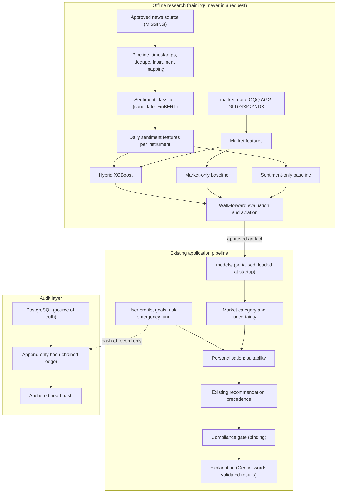

# WealthPilot AI — Research Enhancement Track: Architecture and Feasibility (Phase B0)

**Status:** Phase B0 — design and feasibility only. Nothing here is implemented.
**Track:** Research Enhancement Track (B0–B10). These are not project phases;
the existing Phases 0–36 are unchanged and no Phase 37 exists.
**Date of inspection:** 2026-10-12.
**Scope guard:** this document is the only file created by B0. No application
code, schema, dependency, dataset, model artifact or demo data was touched.

**How to read the labels.** Every statement is tagged:

- **[VERIFIED]** read from the repository or a dataset during B0.
- **[PROPOSED]** a design decision this document recommends, not yet approved.
- **[UNVERIFIED]** an assumption or outside fact that B0 could not confirm.
- **[MISSING]** data or a resource that does not exist in the project.
- **[FUTURE]** work for a later, separately authorised phase.

---

## 1. Executive summary

The proposal has four parts: financial-behaviour features, news-sentiment
features, a sentiment-aware hybrid market model, and a tamper-evident audit
layer. The inspection shows that parts of it are feasible now and parts are
blocked by data that does not exist in the project.

| Component | Feasibility | Main reason |
| --- | --- | --- |
| Financial-behaviour features (B1) | **Partly feasible, much narrower than described** | An individual has one snapshot of annual income, essential spending, liquid savings and a monthly contribution. There is no discretionary spending, no investment holdings and no time series. |
| Historical investment preference | **Feasible only for FAR-Trans-linked customers** | Real transaction history exists only in FAR-Trans (2018-01 to 2022-11). A new application user has none. |
| News sentiment (B2/B3) | **Blocked until a data source is approved** | The repository holds no news or text data at all, and no NLP library is installed. |
| Hybrid XGBoost market model (B4) | **Feasible as an experiment, with a low prior of a large effect** | Market data exists, but the existing models did not beat a naive baseline significantly, and the evaluation sample is small. |
| Personalised opportunity ranking (B5) | **Feasible only inside existing architecture limits** | ADR-016/ADR-017 and the PROJECT_PLAN constraint forbid forecasts steering the optimizer. A market signal may only nudge within the compliance-approved envelope. |
| Audit ledger (B7/B8) | **Feasible and low-risk** | An application-level append-only hash chain in PostgreSQL needs no new dependency. A real blockchain adds cost without a matching threat. |

Three findings change the proposal materially:

1. **There is no news data and no sentiment tooling.** The whole sentiment
   branch depends on a licensed, timestamped historical news source that must
   be found and approved first.
2. **The user's example cannot be computed from the current schema.** The
   system stores annual income and one monthly contribution; it does not store
   ₹50,000 of spending, ₹30,000 of savings and ₹20,000 of investing as separate
   flows.
3. **The asset universe is three US-listed instruments.** QQQ, AGG and GLD are
   priced in USD. A ranking of "gold versus a diversified equity or fixed-income
   fund" for an Indian user compares US proxies, not Indian instruments.

**Recommended primary target:** the next 5-trading-day realised-volatility
category (a three-class target), with the existing regime classification as a
secondary target. This is a **[PROPOSED]** decision for approval, not a settled
one (section 10).

**Recommended audit design:** a hash-chained, append-only ledger table in the
existing PostgreSQL database, with optional external anchoring of the head hash
(section 15).

---

## 2. Existing architecture findings

### 2.1 Documentation hierarchy [VERIFIED]

`CLAUDE.md` → `docs/DECISIONS.md` → `docs/RULES.md` → `docs/ARCHITECTURE.md` →
`docs/PRD.md` → `docs/DESIGN.md` → `docs/SECURITY.md` → `docs/TEST_PLAN.md` →
`docs/MEMORY.md` → `TASKS.md` → `reports/`. `docs/BUILD_PLAN.md` exists;
`BUILD_PLAN.md` at the repository root does not. `docs/PROJECT_PLAN.md` and
`docs/MASTER_PROMPT.md` exist and `CLAUDE.md` says PROJECT_PLAN wins on
architecture.

**Placement note.** `CLAUDE.md` section 2 does not list a research-design
document. This file is placed in `docs/` because that is where design documents
live. If you prefer another location, moving it is trivial.

### 2.2 Decisions this proposal must respect [VERIFIED]

| Decision | Statement (paraphrased from `docs/DECISIONS.md` / PROJECT_PLAN) | Effect on the proposal |
| --- | --- | --- |
| ADR-007 | Training is offline; nothing trains in a request, node or agent. | All sentiment and hybrid training stays in `training/`. |
| ADR-008 | No shuffled splits on time series; expanding-window walk-forward with an embargo; market models target returns or volatility, never price levels. | Reused unchanged for B4/B6. |
| ADR-010 | FAR-Trans (risk/behaviour) and Kaggle (expense) are never linked. | News/sentiment must not be joined to either population by invention. |
| ADR-014 | Deterministic backend is the sole numerical authority; Gemini explains only. | The hybrid score is computed deterministically; Gemini only words it. |
| ADR-015/016 | Compliance is binding and fail-closed. Precedence: Compliance > Savings-first > Risk > Goal > Market. Market may only nudge within the approved envelope. | A sentiment-aware signal sits at the lowest precedence. |
| ADR-017 | Exactly three strategies (MVO, HRP, 1/N); universe QQQ, AGG, GLD. | No new strategy, and no new asset without a new ADR. |
| ADR-019 | No trade execution, fund transfer or brokerage integration. | Opportunity ranking is information only. |
| ADR-020/024 | Prototype auth; data scoping without authorisation. | The audit design must not be described as access control. |
| ADR-023 | Raw datasets are immutable. | News data would go to a new raw location and never alter existing files. |
| PROJECT_PLAN §2.4 | "Do **not** feed LSTM point forecasts into the optimizer as expected returns… the model emits a **regime label** which adjusts constraint bounds, never the return estimates." | The strongest constraint on section 13. |
| `CLAUDE.md` §10 | Never invent a financial formula or threshold not already specified or implemented. | Every B1 ratio needs explicit approval and an ADR. |
| `CLAUDE.md` §5 | Do not add a library outside the approved list without asking. | `transformers`, a deep-learning backend for it and any news client need approval. |

**No conflict was found that blocks B0.** Section 13.3 lists the places where
later phases would conflict if implemented naively.

### 2.3 Market pipeline [VERIFIED from `models/metrics.json` and `training/market/`]

- **Instruments:** `^IXIC`, `^NDX`, `QQQ`, `AGG` (bond proxy), `GLD` (gold
  proxy). Source: `yfinance==0.2.66`, stored in the `market_data` table
  (OHLCV, `source` column). Volume is present.
- **Frequency and span:** daily, 2022-01-03 to 2026-09-11 per instrument, with
  no missing OHLC days recorded.
- **Targets:** simple return (`close.pct_change()`) and 20-day rolling realised
  volatility. Forecast horizon 1 day.
- **Validation:** expanding window, 504 initial training days, 5-day embargo,
  63-day test windows, 10 windows, 630 test observations per instrument.
  `random_state=42`.
- **Models:** naive, ARIMA, LSTM, GRU (return) and GARCH (volatility), with
  Diebold-Mariano tests against naive.
- **Regime labels:** Trending / Volatile / Range-bound, from a 20-day rolling
  volatility and trend, with thresholds at the training window's 66th
  percentiles (`training/market/regime.py`).
- **Results already on record:** no learned return model beats naive
  significantly. For `^IXIC` the Diebold-Mariano p-values against naive are 0.43
  (ARIMA), 0.24 (LSTM) and 0.46 (GRU). Directional accuracy is about 52–58%.
  Regime counts per instrument are roughly 420–440 Range-bound, 90–110 Trending
  and 100 Volatile out of 630. GARCH is the volatility model.
- **Use downstream:** `core/recommendation.py::select_strategy` reads the QQQ
  regime through a fixed preference table. It nudges the strategy and never
  overrides risk or goals.

### 2.4 Portfolio and compliance [VERIFIED]

- `core/optimizer.py`: `ASSET_UNIVERSE = ["QQQ", "AGG", "GLD"]`,
  `GENERAL_SINGLE_ASSET_CAP = 0.70`, per-risk-level QQQ bands.
- `core/compliance.py` and `config/compliance_rules.yaml`: five rules (weights
  sum to one, no negative weights, QQQ within band, single-asset cap,
  emergency-fund savings-first). Four check the optimizer's own output; one
  checks the emergency fund and fails closed.
- `enforce_gate` raises on REJECT and nothing catches it.

### 2.5 Personal data [VERIFIED from `db/models.py`]

Individual tables: `customers` (name, age, income, employment, customer type,
capacity), `financial_inputs` (monthly essential expenses, current liquid
assets, contribution amount, return/inflation assumptions), `financial_goals`,
`questionnaire_answers`, `customer_risk_snapshots`, `transactions`. Household
tables hold income, expenses, assets (with liquidity) and liabilities, but
ADR-033 forbids any household figure from entering an individual analysis.

### 2.6 Dependencies [VERIFIED from `pip list` and `pyproject.toml`]

Installed and relevant: `xgboost 2.1.2`, `scikit-learn 1.5.2`, `tensorflow
2.17.0`, `statsmodels`, `arch`, `shap`, `yfinance 0.2.66`, `requests`,
`beautifulsoup4`. **Not installed:** `torch`, `transformers`, `tokenizers`,
`sentencepiece`, `nltk`, any news client, any blockchain library.

### 2.7 Hardware [VERIFIED]

Intel i7-1165G7, 15.7 GB RAM, NVIDIA MX450 (a low-end GPU) plus integrated
graphics. Inference with a BERT-sized classifier is feasible on CPU for tens of
thousands of short texts; fine-tuning is not realistic on this machine.

---

## 3. Research problem

The system already ranks nothing by market conditions beyond a coarse regime
nudge, and the existing return forecasts add no demonstrable skill. The open
question is whether news-tone information carries any predictive signal about
market conditions that price history alone does not, and whether that signal
can make a recommendation more relevant without weakening safety.

The honest framing is a **test of a hypothesis that may fail.** Daily
return prediction is close to noise (section 2.3), so a null or inconclusive
result is a likely outcome and a legitimate research finding.

---

## 4. Research questions and hypotheses

| RQ | Hypothesis | Falsified if |
| --- | --- | --- |
| RQ1 | Sentiment features improve prediction of the chosen market target beyond price features. | The hybrid does not beat market-only on out-of-sample walk-forward folds by more than the pre-registered minimum effect, or the gain is within the confidence interval. |
| RQ2 | The hybrid beats both market-only and sentiment-only baselines. | The hybrid is not better than the better of the two. |
| RQ3 | Behaviour and investment-history features improve the relevance of ranked alternatives. | Relevance cannot be measured with real labels (see section 13.5), in which case RQ3 is reported as **not testable** rather than answered. |
| RQ4 | A cryptographic audit layer detects modification of audited records. | A planted modification is not detected by the verification routine. |

---

## 5. Available data and data gaps

| Need | Present? | Detail |
| --- | --- | --- |
| Daily market prices, 5 instruments | **Yes [VERIFIED]** | 2022-01-03 to 2026-09-11, in `market_data`. |
| FAR-Trans customer transactions | **Yes [VERIFIED]** | 388,048 rows, 29,090 customers, 2018-01-02 to 2022-11-30. Median 3 transactions per customer (maximum 6,288). |
| FAR-Trans prices | **Yes [VERIFIED]** | 703,303 rows, 2018-01-01 to 2022-11-29, 806 ISINs (Stock 293, Bond 225, MTF 318), euro-based Greek bank data. |
| Overlap of customer history and market data | **Thin [VERIFIED]** | The two sources overlap only in 2022 (about 84,000 transactions). |
| Financial news text | **No [MISSING]** | Nothing in the repository. |
| Historical news with publication timestamps | **No [MISSING]** | Must be sourced, licensed and approved. |
| Article-to-instrument mapping | **No [MISSING]** | Would be created in B2. |
| Individual spending, savings and investing flows | **No [MISSING]** | One snapshot only (section 6). |
| Individual holdings and investment history for new users | **No [MISSING]** | Only FAR-Trans-linked customers have transactions. |
| Indian market instruments | **No [MISSING]** | The universe is US-listed ETFs in USD. |
| Relevance labels for "a better recommendation" | **No [MISSING]** | There is no ground truth for recommendation quality. |

---

## 6. Financial-behaviour feature feasibility

### 6.1 What the schema can support [VERIFIED]

| Candidate feature | Computable? | Note |
| --- | --- | --- |
| Essential-spending-to-income | **Yes, as a lower bound only** | Needs monthly income. The profile stores **annual** income; dividing by 12 is a new formula that needs approval. Discretionary spending is not stored, so total expense-to-income is **not** available. |
| Contribution-to-income | **Yes** | `contribution_amount` is one monthly figure. It does not separate saving from investing, so a split of "₹30,000 saved and ₹20,000 invested" cannot be represented. |
| Liquid-savings coverage (months of essentials) | **Yes** | Already computed by the emergency-fund rule (six-month target). Reuse that result; do not compute a second one. |
| Investment concentration and asset preference | **FAR-Trans-linked customers only** | From `transactions` with asset category and ISIN. New users have none. |
| Saving or investing consistency over time | **No** | Needs a time series of contributions; there is none. |
| Existing asset allocation | **Household only** | Individuals have no asset records; household figures cannot enter an individual analysis (ADR-033). |

### 6.2 The user's example [VERIFIED limitation]

A user with ₹1,00,000 monthly income, ₹50,000 spending, ₹30,000 saved and
₹20,000 invested cannot be entered today. The nearest representation is annual
income ₹12,00,000, essential spending, a liquid balance and one contribution.
Supporting the full example needs new input fields, which is a schema and API
change and therefore a **[FUTURE]** decision for you, not a B1 detail.

### 6.3 Rules carried into B1 [PROPOSED]

- Unknown is `null`, never zero; double-counting between "saved" and "invested"
  is prevented by defining each flow once.
- Any new ratio needs a written definition and an ADR before it is computed
  (`CLAUDE.md` §10).
- No inference of emotion or psychology from ratios.
- Questionnaire answers are stored but **no analysis step reads them today**.
  Using them as features changes that and needs your decision plus a data-use
  note; the documentation records no consent mechanism.
- Behaviour features are used for **suitability and personalisation**, not as
  predictors in the market model (section 10.4).

---

## 7. Financial sentiment data feasibility

### 7.1 Current state [VERIFIED]

No news data, no text tooling, no API key for any news source, and no stored
article table. `yfinance`'s `Ticker.news` returns only recent items **[UNVERIFIED
for depth]** and cannot supply a multi-year historical archive.

### 7.2 What a usable source needs [PROPOSED requirements]

- Publication timestamp with time zone, separate from ingestion time.
- Coverage of at least 2022-01 to the present for the US instruments.
- A licence that allows research use and local storage.
- Stable identifiers for deduplication, with enough headline or summary text.
- Sufficient daily volume per instrument to aggregate (to be measured, not
  assumed).

### 7.3 Candidate sources [UNVERIFIED]

*Superseded by the verified B2 findings in section 7.5.*

B0 did not contact any provider and does not claim any is available. Candidate
categories to evaluate in B2: a licensed financial-news API with historical
depth, a public research archive of news headlines, and the GDELT global event
database. Each needs a check of historical depth, licence, rate limits, cost and
timestamp precision before approval. **If none passes, the full experiment is
not feasible and B2–B4 should stop there.**

### 7.4 Temporal-alignment risk [VERIFIED]

Prices are daily closes. Headlines arrive at arbitrary times, including after
the close. A headline published after the close of day *t* may only be used for
day *t+1*. Time zones, weekends and holidays need an explicit rule. Mapping a
general-market headline to a specific ETF is a weak, noisy link that must be
described as such.

### 7.5 Phase B2 findings (2026-10-12)

Full evidence: `reports/phaseB2_historical_news_source_evaluation.md`.

- **[VERIFIED]** The existing walk-forward needs news from 2021-12 (lookback)
  through the 2026-07-20 close, where the last one-day-ahead forecast is made.
  - Training returns start 2022-01-04; test returns run 2024-01-16 → 2026-07-21.
  - `market_data` holds 1,177 prices and 1,176 returns per instrument.
  - *Dates corrected in B2-F (section 7.6). B2 had mapped the windows onto
    price dates, which put them one trading day early.*
- **[VERIFIED]** GDELT 2.0 GKG covers the window except for a 17-day outage in
  June–July 2025, which B2-F found (section 7.6). Its 15-minute files are present
  at 2022-01-03, 2024-01-12, 2026-07-20 and 2026-09-11.
  - Each file carries one UTC batch time, a usable first-availability stamp.
  - Rows carry URLs, themes, a lexicon tone and page titles; there is no article
    body.
  - The licence permits unrestricted academic use and redistribution with
    citation.
  - It supports market/asset-class mapping: `ECON_STOCKMARKET`, interest-rate
    themes, `ECON_GOLDPRICE`. It does not support ticker-level mapping.
  - The raw English stream for the window is roughly 1 TB compressed. B2-F
    refines this to ≈0.90 TB.
- **[VERIFIED]** No academic corpus found covers the 2024-2026 test period.
  FNSPID ends in 2023 and NIFTY in 2020.
- **[VERIFIED]** Benzinga news (via Alpaca or Massive) has an immutable
  `created`/`published` time, a separate `updated` time, and ticker tags.
  Individual-plan terms are personal/non-commercial with no redistribution, so
  research and derived-result rights are **[UNVERIFIED]**.
- **[VERIFIED]** These sources are not usable for this design:
  - Finnhub: its terms require deleting data at subscription end and forbid
    sharing derived results without approval.
  - Tiingo (individual plans) and GDELT's DOC API: only 3 months of history.
- **[PROPOSED]** GDELT is conditionally recommended as the primary source for a
  market-level experiment. Nothing is approved; an ADR should follow your
  decision, not precede it.

### 7.6 Phase B2-F findings (2026-10-12)

Full evidence: `reports/phaseB2F_gdelt_acquisition_feasibility.md`. Nothing was
acquired and no acquisition route is approved.

- **[VERIFIED]** Corrected window.
  - `training/market/train.py` builds its windows over the return series, so
    test returns run 2024-01-16 → 2026-07-21.
  - 37 returns (2026-07-22 → 2026-09-11) are unused.
  - News is needed from 2021-12-01 through 2026-07-20 20:00 UTC (16:00 ET), the
    cutoff for the last forecast.
  - `train.py` re-fetches yfinance with no end date. Re-running it after about
    2026-10-19 would add an 11th window, so the research track should freeze the
    stored snapshot.
- **[VERIFIED]** GDELT 2.0 has no files at all from 2025-06-14 18:00 to
  2025-07-02 02:00 UTC (1,665 batches), plus 9 batches on 2025-06-12.
  - The events, mentions, English GKG and translated GKG streams are all
    missing.
  - In test window 6, 10 test returns have no news for their forecast interval.
    They must be null, never neutral.
- **[VERIFIED]** Each raw file's Last-Modified is 8–12 minutes before its nominal
  batch time (14 of 14 files sampled, 2021–2026). Nominal batch time + 15 minutes
  is therefore a conservative availability time.
- **[ESTIMATED]** Download and storage sizes:
  - the English stream for the window is ≈0.90 TB (95%: 0.86–0.93 TB) across
    162,512 batch slots. B2-G measured it exactly: 0.860 TB for the 160,658
    listed files (section 7.7);
  - filtered output is ≈2–6 GB compressed;
  - neither local drive can hold the raw archive.
- **[VERIFIED]** BigQuery's sandbox needs a Google account and Cloud project but
  no billing.
  - It allows 1 TiB of queries per month, 10 GiB of storage and 60-day table
    expiry.
  - Export to Cloud Storage needs billing.
  - The query size for this window is only estimated, at ≈0.7–3.6 TiB.
- **[VERIFIED]** `datasets/raw/gdelt/` is already git-ignored, including any
  README inside it. `datasets/processed/` is not.
- **[PROPOSED]** Route A is conditionally recommended: stream the English files,
  filter them locally, and keep no raw archive. No ADR has been written; it
  should follow your decision.

### 7.7 Phase B2-G findings (2026-10-12)

Full evidence: `reports/phaseB2G_gdelt_pilot_audit.md`. B2-G downloaded one
English GKG file (`20251223144500`) and the master file list, then deleted both.
Full acquisition is not approved.

- **[VERIFIED]** The master list (snapshot SHA-256 `7e5d2c2e…`) covers the window.
  - It lists 160,658 of 162,512 slots (2021-12-01 00:00 → 2026-07-20 19:45 UTC),
    totalling exactly 860,483,377,717 bytes.
  - The 1,854 absent slots are missing in the events, mentions and GKG streams
    alike:
    - the June 2025 outages (1,674);
    - a March 2023 disruption (147);
    - 33 isolated single slots.
  - Separately, an 83-slot run of near-empty files on 2022-11-10/11 is present
    but under 160 KB per file.
- **[VERIFIED]** Effect on forecast days, using the B2-F availability rule:
  - **Test:** 12 of 630 forecast days have under 90% coverage, all from the June
    2025 outage.
  - **Training:** 3 days (2022-11-11, 2023-03-22, 2023-03-23) have under 50%.
- **[VERIFIED for the sample file]** The file matches the GKG 2.1 codebook.
  - 27 columns, no parse errors, a title on every row, blank
    `TRANSLATIONINFO`.
  - The file name, `V2.1DATE` and record-ID prefixes are identical.
  - Its MD5 equals both the server ETag and the master-list entry.
  - It was written about 9 minutes before its nominal batch time.
- **[MEASURED, once]** Resource use:
  - **Parsing:** streaming from the in-memory zip parses a 19 MB file in 0.11 s
    with about 5 MB of Python allocations; incremental parsing is feasible.
  - **Network:** throughput was 41–44 Mbit/s per connection, with ≈1.1–1.4 s
    latency per request. Full acquisition is therefore about 2 days with a few
    connections, or up to about 4.6 days fetching one file at a time
    [ESTIMATED].
- **[PROPOSED]** Filter observations from one batch:
  - `WB_2936_GOLD` and the broad rates themes were noise in the titles read.
  - `ECON_GOLDPRICE` was precise but rare.
  - 17.8% of rows repeated a title within the batch.
  - The filters remain proposals until you approve them.

### 7.8 Phase B2-H findings (2026-10-12)

Full evidence: `reports/phaseB2H_pre_acquisition_readiness.md`. Full acquisition is
not approved.

- **[VERIFIED]** The master list is not a complete index. Of the 180 absent slots
  never checked before, header-only checks showed:
  - 178 confirmed absent;
  - 1 inconclusive, because only a cached 404 could be obtained;
  - 1 present though unlisted: `20220207190000`, published normally.

  The acquisition must therefore check unlisted grid slots itself.
- **[VERIFIED]** How the server behaves:
  - `http://` requests are answered with a 301 to the same HTTPS URL written with
    `:443`.
  - The CDN caches header responses for up to an hour and ignores client
    no-cache requests, so independent re-checks must be over an hour apart.
- **[VERIFIED]** The market calendar is officially documented.
  - Official NYSE Group early closes (1:00 p.m. ET) in the window: 2022-11-25;
    2023-07-03 and 11-24; 2024-07-03, 11-29 and 12-24; 2025-07-03, 11-28 and
    12-24; none in 2026 before November.
  - The stored trading calendar matches NYSE's official holiday tables for
    2022–2026, plus an unscheduled closure on 2025-01-09.
- **[VERIFIED]** The evaluation basis is fingerprinted.
  - `market_data` snapshot SHA-256 `563afd21…`: 5 instruments × 1,177 rows,
    stored at 4 decimals. `train.py` used unrounded yfinance values held in
    memory.
  - No holdout is defined in the code or docs.
- **[VERIFIED]** Coverage is exact, using early-close-aware forecast intervals:
  - minimal window: 98.86% of slots present;
  - first training window: 99.64%, with 3 days under 50%;
  - test: 98.10%, with 12 of 630 days under 90%;
  - the unused 37-day tail: 100%.
- **[PROPOSED]** A frozen filter specification `gdelt_filter_v1` and a missing-data
  policy, both awaiting your approval:
  - **Filter:** series definitions narrower than capture; company-level notices
    flagged; causal story-level deduplication.
  - **Missing data:** primary coverage threshold 0.75; missing never neutral.

### 7.9 Phase B2-I findings (2026-10-12)

Full evidence: `reports/phaseB2I_filter_review_and_acquisition_preparation.md`.
Nothing was downloaded. Full acquisition and B3 are not approved.

- **[VERIFIED]** No GDELT title sample is retained.
  - **What was ever downloaded:** three batches. B2 took 2022-01-03 14:30 and
    2024-01-12 21:00 UTC; B2-G took 2025-12-23 14:45 UTC.
  - **What remains:** all three were deleted, and only counts were kept.
  - **Training period:** only the 2022 batch belongs to it, and its titles were
    never examined.
  - **Consequence:** the empirical filter review is blocked until a new
    training-period sample is authorised.
- **[VERIFIED]** The qualitative evidence behind `gdelt_filter_v1` came from one
  test-period batch (2025-12-23), read without returns or forecasts. Future filter
  evidence must come from the first training window only, meaning batches up to
  2024-01-04 20:45 UTC.
- **[VERIFIED design constraint]** The acquisition stores captured rows only, so
  missed stories cannot be measured afterwards from stored data.
  - **What is irreversible:** the capture rule, the stored columns and the
    audit-sample rate.
  - **How to fix them:** from a raw training-period sample, before the full
    download.
  - **Safeguard:** the acquisition should also keep a small hash-selected audit
    sample of uncaptured rows.
  - **What is not:** series rules, flags and deduplication can be recomputed from
    stored rows.
- **[VERIFIED]** The cutoff calculation needs IANA time-zone data.
  - **On Windows,** `zoneinfo` gets it from the `tzdata` package.
  - **The project venv has it:** `tzdata` 2026.4, via pandas.
  - **The system Python 3.13 does not,** so acquisition code must run in the
    project venv.
- **[PROPOSED]**
  - a pre-registered review sample: 192 training-period batches, plus 192 for
    confirmation; the seed and list SHA-256 are in the report;
  - a blind labelling protocol;
  - a five-table manifest schema;
  - a streaming design that downloads one batch at a time, with byte-budget and
    disk guards.
- **Decisions recorded for B2-I:**
  - the minimal window, so there is no news holdout;
  - the June 2025 outage accepted without further checks;
  - filters approved for labelled review only.

### 7.10 Phases B2-J to B2-L and B2 status (2026-10-13)

Full evidence:

- `reports/phaseB2J_development_sample_approval_checklist.md`;
- `reports/phaseB2K_gdelt_tool_implementation_report.md`;
- `reports/phaseB2L_gdelt_development_sample_and_filter_review.md`;
- `reports/phaseB2_completion_and_acquisition_readiness.md`.

Nothing was downloaded.

- **[VERIFIED]** The isolated tool exists in `backend/wealthpilot/data/gdelt/`.
  - **Dependencies and isolation:** standard library + PyYAML only, imported by no application module.
  - **Tests:** 146 offline tests with sockets and the database blocked.
  - **Locked off in this build:** network access, the development sample and the confirmation sample.
  - **Full acquisition:** has no enabling switch.
- **[VERIFIED]** The availability rule is implemented as a pure, fail-closed function. A server
  `Last-Modified` counts only if all of these hold:
  - it is a strict GMT date and is not after the response `Date`;
  - it is not more than 60 minutes before the nominal batch time;
  - it is corroborated by the zip member time when the response came from the CDN cache.

  Otherwise the batch is recorded as invalid with a reason and treated as missing.
- **[VERIFIED]** Implementation constraints worth keeping:
  - `httpx` is declared only as a dev extra, and `requests` is undeclared (installed through
    yfinance), so runtime downloads use `http.client`;
  - YAML reads an unquoted all-digit hash as a number, so approval hashes must be quoted;
  - "the next stamp in the block's order" would reach the confirmation stamps, so substitution skips
    both stage lists.
- **[BLOCKED]** The development sample and the labelled review. The data allowance is unconfirmed and
  no approval record exists. B2 is complete as research design but not as acquisition readiness.
  *(Superseded in part, 2026-10-16: the development sample was acquired on 2026-10-13. The labelled
  review is still pending. See section 7.11.)*

### 7.11 B2 status after acquisition and annotation preparation (2026-10-16)

Full evidence: `reports/phaseB2_remaining_work_and_completion_report.md`. This is a **partial
completion**: B2 is complete in research design and tooling, and not complete as an ingestion phase.

- **[VERIFIED]** The development sample is acquired and verified: 192 of 192 batches, 384 requests,
  1,000,147,201 B, with checksums, archive integrity and availability times checked
  (`phaseB2M_development_sample_acquisition_report.md`).
- **[VERIFIED]** The review dataset has 1,493 items (312 overlap, 1,181 non-overlap). **0 are labelled**
  and **no AI suggestion exists.** The sealed key has not been opened.
- **[VERIFIED]** A validator gap was found and fixed. An AI-based `label_basis` used to need only that a
  suggestions file *existed*. It now needs a valid suggestion **for that item** (known item, one row,
  not an overlap item, marked `ai`, rubric-valid). The file is read only when a label claims an AI basis.
- **[VERIFIED]** `annotate freeze` and `annotate evaluate` exist and are tested on synthetic data. The
  freeze refuses until every item is labelled and valid. Evaluation opens the sealed key only after a
  matching freeze, and returns aggregates only. Agreement is intentionally not computed.
- **[VERIFIED]** Offline tests: 262 pass in `tests/backend/data/gdelt/`.
- **[VERIFIED]** The GDELT network and development-sample switches are still `True` after the
  acquisition finished. Locking them is reversible and would break one test (the one asserting the
  post-acquisition state). **Not changed; awaiting your approval.**
- **[PROPOSED, not approved]** The B2-T proposal for AI-assisted annotation of all 1,493 items. Five
  approvals are required (methodology, design, provider, data handling, execution).
- **[BLOCKED]** The labelled review and everything after it (freeze, evaluation, filter decision),
  the window-wide acquisition driver (not built), the full acquisition (not approved), and the ADR.
- **B2 acceptance (section 21):** stored-article metadata is partly met for the sample; duplicates and
  unmapped share are partly reported; the pre-cutoff test is met at the rule level. None is met for the
  full window, which is not ingested.

### 7.12 B2 paused (2026-10-19)

B2 is **paused (deferred), not complete.** Handoff and evidence: `reports/phaseB2_pause_and_research_handoff.md`.

- **[VERIFIED]** Unmet B2 criteria (section 21): the labelled review (0 of 1,493 labelled), the label freeze,
  evaluation against the sealed key and the filter decision, the window-wide driver, full-window ingestion
  (not approved) and the B2 ADR. Stored-article metadata and duplicate reporting are met for the 192-batch
  development sample only.
- **[VERIFIED]** The AI-assisted annotation pipeline is built and disabled (build lock `False`, no adapter, four
  approval gates unmet). The sample, labels, backups and approval records are kept.
- **[PLAN]** The next phase in dependency order is **B3**, which is blocked (needs the B2 labelled data and
  a dependency approval) and would produce sentiment features. Unvalidated GDELT sentiment is not an input to any model.
- **[PROPOSED, not approved]** A market-only stage of B4 (models A and D, section 11) is the only item that uses
  existing data. The plan makes B4 depend on B3, so running it first needs your approval to re-sequence.
  The minimal specification is in the handoff report, section 4.

---

## 8. Proposed sentiment pipeline [PROPOSED, FUTURE]

1. **Acquire** from an approved source into a new raw location, never altering
   existing raw data, recording source, retrieval time and licence.
2. **Normalise** timestamps to UTC, keep `published_at` and `ingested_at`
   separate, and drop records without a publication time.
3. **Deduplicate** by canonical URL and near-duplicate headline hashing, and
   keep a count of duplicates removed.
4. **Map** each article to instruments by explicit rules (ticker mention,
   sector or index keyword). Keep unmapped articles out of per-asset features
   and record the share.
5. **Score** with a financial-text classifier. FinBERT is the leading
   candidate. Its licence, availability and hardware fit are **[UNVERIFIED]**
   and need `transformers` plus a deep-learning backend that is not in the
   approved stack. Scoring is offline, batched, and stored with the model
   version.
6. **Aggregate** per instrument per trading day using only articles with
   `published_at` before the day's cutoff. Features: mean positive minus
   negative score, article count (coverage), dispersion across articles, and a
   "no news" indicator that is distinct from neutral.
7. **Validate** the classifier on a labelled financial-phrase sample before
   trusting it, and report how well it matches human labels on this text.

Sentiment output never triggers a buy or sell decision.

---

## 9. Hybrid model candidates

| Candidate | Role | Notes |
| --- | --- | --- |
| XGBoost (installed) | First hybrid candidate | Handles small tabular data, missing values and mixed features. Not assumed to win. |
| Regularised logistic regression | Interpretable baseline | Same features, fewer assumptions. |
| Existing naive, ARIMA, GARCH | Mandatory baselines | Already on record. |
| LSTM/GRU | Optional | Existing artifacts are return models; they are not retrained in the research track unless approved. |

Do not assume XGBoost beats ARIMA, GARCH, LSTM or the existing baselines.

---

## 10. Prediction target and rationale

### 10.1 Options considered

| Target | Verdict | Reasoning |
| --- | --- | --- |
| Next-day return | **Rejected as primary** | Existing models are at noise level. Prediction error is dominated by noise, so sentiment effects would be undetectable at the available sample size. |
| Next-day return direction | **Rejected as primary** | With 630 test observations the standard error of an accuracy figure is about 2 percentage points (square root of 0.25/630), so the 95% interval is roughly ±3.9 points. Improvements smaller than that cannot be distinguished from chance. |
| Existing regime class (Trending/Volatile/Range-bound) | **Secondary** | Matches ADR-016 and the PROJECT_PLAN constraint. The label is a function of trailing returns, so it has to be built carefully to avoid overlap leakage. |
| **Forward realised-volatility category** | **Recommended primary** | Volatility is persistent and measurable, news tone plausibly relates to it, the existing GARCH baseline is strong, and a category is exactly what the recommendation layer may use to adjust constraint bounds. |

### 10.2 Proposed primary target [PROPOSED, needs approval]

The category (Low, Normal, High) of realised volatility over the **next 5
trading days**, with category boundaries taken from the training window's
terciles only. The label window is *t+1 … t+5* and never overlaps the feature
window.

### 10.3 Leakage handling [PROPOSED]

Because the label spans 5 days, the embargo must be at least 5 trading days
(the existing harness already uses 5). Features at day *t* use only data
available at the close of *t* and news published before the cutoff.

### 10.4 What stays out of the market model [PROPOSED]

User financial-behaviour features are not predictors of market outcomes. They
enter only the personalisation layer (section 13). Mixing them into the market
model would let individual data leak into a market target.

---

## 11. Baseline and ablation experiments

| Model | Inputs | Purpose |
| --- | --- | --- |
| A — market-only | Price, return, volatility, momentum and volume features | The bar the hybrid must clear |
| B — sentiment-only | Aggregated sentiment features | Whether sentiment alone carries any information |
| C — hybrid | A + B features, XGBoost | The research claim |
| D — existing | Naive, ARIMA/GARCH, regime rule as applicable | Continuity with the delivered system |
| E — control | Hybrid with sentiment permuted in time (placebo) | Detects spurious gains from the pipeline itself |

Ablations: remove coverage features, remove dispersion, vary the aggregation
window, and compare per instrument. The incremental value of sentiment is the
difference between C and A with a confidence interval across walk-forward folds.
Multiple comparisons across instruments and targets must be corrected, and
negative results reported.

---

## 12. Leakage-safe evaluation methodology [PROPOSED]

- Chronological expanding-window walk-forward, reusing the existing harness
  (504 initial training days, 63-day test windows, 5-day or longer embargo).
- All preprocessing and category thresholds fit on the training fold only.
- A final holdout period that no experiment touches until the last step.
- Point-in-time feature construction, with unit tests that fail if a feature
  depends on a timestamp later than its prediction time.
- Pinned seeds (`random_state=42`), recorded library versions and dataset
  hashes, in the style of the existing `metrics.json`.
- Metrics by target: for the category target, macro-F1, balanced accuracy and
  per-class recall; for a regression secondary, MAE and RMSE against the naive
  and GARCH baselines. Use Diebold-Mariano style tests where applicable and
  report confidence intervals.
- **Sample-size caveat:** about 1,140 usable daily observations per instrument
  after the initial training window and overlapping 5-day labels reduce the
  effective sample further. The study can detect only moderate effects. This is
  stated up front so a null result is interpretable.
- Portfolio claims need a separate backtest (costs, rebalancing, benchmark,
  drawdown, turnover, concentration). A better forecast metric does not by
  itself show better portfolio outcomes.

---

## 13. Personalised recommendation architecture

### 13.1 Flow [PROPOSED]

The market signal is an **input to the existing precedence chain**, not a new
decision-maker.

1. Existing pipeline decides compliance, savings-first and the risk-based base
   strategy.
2. A validated market category (and its uncertainty) is added to the existing
   market input, replacing nothing.
3. A separate **personalisation layer** evaluates suitability: risk profile,
   horizon, goals, emergency fund, liquidity, concentration and, where genuine
   history exists, past asset preference.
4. Output is a ranked, explained list of **alternatives to investigate**, each
   with risks and evidence, never an instruction to buy.

### 13.2 What the signal may and may not do

- It may nudge, within the compliance-approved envelope, in the same manner as
  today's regime preference.
- It may not set expected returns for the optimizer.
- It may not change a weight directly.
- It may not override a compliance REJECT, a savings-first outcome or a risk
  category.

### 13.3 Conflicts that later phases would hit [VERIFIED]

| Proposal wording | Conflicting rule | Resolution proposed |
| --- | --- | --- |
| "Investment opportunity ranking" from forecasts | PROJECT_PLAN §2.4 forbids point forecasts feeding the optimizer. | Rank by category and uncertainty, not predicted returns. |
| Alternatives beyond QQQ/AGG/GLD | ADR-017 fixes the universe. | A new ADR approved by you before any new asset. |
| New ratios and features | `CLAUDE.md` §10. | Define each in an ADR first. |
| New libraries | `CLAUDE.md` §5. | Ask before adding `transformers` or a deep-learning backend. |
| Sentiment influencing recommendations | ADR-016 precedence puts Market last. | Keep it last and non-overriding. |

### 13.4 The "gold to equity or fixed income" example

With the current universe, the comparison is GLD (gold proxy) versus QQQ
(technology-heavy US equity, not diversified) versus AGG (US aggregate bonds).
The user's currency is rupees, while these instruments are priced in USD, so
currency risk and tax and cost differences are not modelled. The ranking could
only be presented as an illustration about these three US proxies. Genuine
comparison for an Indian user needs Indian instruments (index funds, gold in
rupees, debt funds), which are **[MISSING]** and need an ADR and a data source.

### 13.5 Evaluating "relevance" (RQ3) [UNVERIFIED]

No ground truth exists for whether an alternative is a better recommendation.
Possible proxies (for example agreement with later FAR-Trans behaviour) are weak
and cover only 2018–2022 history. RQ3 may have to be reported as **not
testable** with the available data.

---

## 14. Integration with existing modules

| Existing module | Proposed interaction | Change needed |
| --- | --- | --- |
| `training/market/` | Reuse harness and labelling; add a new training family for the hybrid | New training scripts only |
| `core/recommendation.py` | Read an added market category as a further nudge | Small, ADR-gated |
| `core/compliance.py` | Unchanged and authoritative | None |
| `core/optimizer.py` | Unchanged; no forecast inputs | None |
| `agents/explanation.py` | Gemini words the validated result | Schema field only |
| `api/schemas.py`, OpenAPI types | Additive fields for sentiment and uncertainty | Regenerated types |
| Frontend | Display-only panels in B9 | New components, no calculation |

---

## 15. Blockchain and audit technology comparison

| Option | Privacy | Cost and complexity | Tamper evidence | Fit |
| --- | --- | --- | --- | --- |
| Public blockchain | Poor: public, immutable, cost per write | High, needs wallets and keys, new dependencies | Strong | **Reject.** Disproportionate and a privacy risk |
| Permissioned blockchain (for example a private network) | Better, controlled membership | High: nodes, consensus, operations, new stack | Strong with several operators | Over-engineered for one operator |
| Application-level append-only ledger | Good: stores only hashes and minimal metadata | Low, no new dependency | Strong against edits to audited rows if the head is anchored | **Recommended** |
| Hash-chain table beside PostgreSQL | Same as above | Lowest | Equivalent to the ledger option | The concrete form of the recommendation |

### 15.1 Recommendation [PROPOSED]

An append-only table in PostgreSQL where each entry stores an event type, a
timestamp, a pseudonymous subject identifier, the hash of a canonical
representation of the changed record (with a secret salt held outside the
database), the previous entry's hash and its own chained hash. Verification
recomputes the chain and compares record hashes to current rows. Periodically
publishing the head hash somewhere outside the database operator's control
(for example a signed file or an external timestamp) is what gives tamper
evidence against the operator.

### 15.2 What this protects and what it does not

- **Protects:** detection of after-the-fact modification or deletion of audited
  records and of entries in the ledger itself.
- **Does not protect:** confidentiality, availability, a malicious change made
  before it is audited, an attacker who can rewrite both data and ledger and
  the anchor, or application bugs.
- **Still required:** access control, encryption in transit and at rest, backups,
  and secret management. This prototype has no authorisation layer (ADR-020), and
  an audit ledger does not supply one.
- Hashing is not encryption. Low-entropy fields can be guessed from a plain
  hash, which is why a salted or keyed hash is specified.

---

## 16. Privacy and threat model

### 16.1 Data never placed in the ledger [from your rules]

Names, contact details, identity numbers, income, expenses, savings, assets,
liabilities, transactions, holdings, goals, questionnaire or risk answers,
financial profiles, credentials, secrets and raw payloads.

### 16.2 Threats

| Threat | Mitigation in design |
| --- | --- |
| Direct database edit of a customer record | Hash comparison against the ledger detects it |
| Ledger row edit or deletion | Chained hashes and anchored head detect it |
| Dictionary attack on a hash of a small value | Keyed or salted hashing, key outside the database |
| Replay or reordering of events | Sequence numbers and chaining |
| Concurrent writers forking the chain | Serialised append with a unique sequence constraint |
| Leakage through event metadata | Minimal event types, pseudonymous ids, review before B8 |
| Sentiment pipeline ingesting hostile text | Treat article text as untrusted data; it never reaches a prompt that can alter a number |
| Look-ahead in news timestamps | Separate `published_at` and `ingested_at`, cutoff tests |

### 16.3 Other risks

The documented prototype auth has no per-account authorisation and household
membership needs no consent from the added member. A new feature that reads more
personal data raises the stakes of those disclosed limits.

---

## 17. Proposed architecture diagram

---

## 18. Risks, assumptions and limitations

| Risk | Severity | Note |
| --- | --- | --- |
| No licensed historical news available | **High** | Blocks B2–B4 entirely |
| Small effective sample | **High** | Only moderate effects detectable; null result likely |
| Daily returns are near noise | **High** | Motivates the volatility target |
| News-to-ETF mapping is noisy | Medium | Document the mapped share |
| USD US-ETF universe vs Indian user | **High for B5/B9** | The ranking is illustrative only |
| Customer history (to 2022) vs market data (from 2022) barely overlap | Medium | Limits any evaluation of preference |
| Model cannot be fine-tuned locally | Medium | Use pretrained inference only |
| Scope creep into recommendation changes | Medium | Gate every change with an ADR |
| Overclaiming | **High** | Report negatives; no profit claims |

Assumptions marked **[UNVERIFIED]** throughout (source availability, FinBERT
licence, provider terms) must be confirmed before they are relied on. The
dates in the inspected data (market data to 2026-09-11) are exactly as found in
the repository.

---

## 19. Dependencies and external resources that may eventually be needed

| Item | Phase | Approval needed |
| --- | --- | --- |
| Licensed or public historical news archive | B2 | Yes (source, licence, cost) |
| `transformers` and a deep-learning backend (`torch` or the already-installed TensorFlow path) | B3 | Yes (outside the approved list) |
| A pretrained financial-text model and its licence check | B3 | Yes |
| A labelled financial-sentiment sample for validation | B3 | Yes |
| A news-fetching client | B2 | Yes |
| New raw-data directory (immutable) | B2 | Yes |
| New Alembic migration for ledger table and any stored sentiment | B2, B8 | Yes |
| External place to anchor the ledger head | B8 | Yes |
| Blockchain libraries or Solidity | — | **Not recommended** |

`hashlib`, `hmac` and PostgreSQL are already available; the audit layer needs no
new package.

---

## 20. Phased implementation plan

| Phase | Deliverable | Depends on |
| --- | --- | --- |
| B1 | Behaviour feature design and validation on existing fields; ADRs for any new ratio | Your decision on new inputs |
| B2 | Approved news source, ingestion, provenance, dedupe, mapping, alignment tests | Source approval |
| B3 | Sentiment classifier, validation against labelled text, aggregation | B2, dependency approval |
| B4 | Market-only, sentiment-only and hybrid models, walk-forward | B3 |
| B5 | Personalisation layer and nudge integration, with compliance intact | B4, ADRs |
| B6 | Ablation, leakage audit, robustness, optional backtest, report | B4 (B5 for portfolio claims) |
| B7 | Audit architecture and threat model decision record | Independent of B2–B6 |
| B8 | Ledger implementation and tests | B7, migration approval |
| B9 | Frontend display of insights and integrity status | B5, B8 |
| B10 | Integration tests, documentation, viva material | All |

B7/B8 do not depend on the sentiment work and can proceed in parallel if you
prefer, which de-risks the project if news data cannot be obtained.

**Status (2026-10-19):** B0 done; B1 accepted; **B2 paused**; B3 next and blocked; B4 to B6 and B9 to B10 not
started; B7/B8 not started and independent. See section 7.12 and
`reports/phaseB2_pause_and_research_handoff.md`.

---

## 21. Acceptance criteria for future phases

- **B1:** every feature has a written definition; unknown stays null; tests for
  missing values, double counting, inconsistent periods and extremes; no
  existing calculation changes.
- **B2:** every stored article has source, licence, `published_at` and
  `ingested_at`; duplicates and unmapped share reported; a test proves no
  article can be used before its publication cutoff.
- **B3:** classifier agreement with labelled text reported with its limits; model
  version stored; no live-request training.
- **B4:** all models trained on identical folds; leakage tests pass; baselines
  reproduced; results saved with seeds and dataset hashes.
- **B5:** compliance, savings-first and risk precedence tests unchanged and
  passing; a sentiment signal cannot override a REJECT; explanation shows
  uncertainty.
- **B6:** effect sizes with confidence intervals; negative results reported;
  portfolio claims only from a separate cost-aware backtest.
- **B7:** written threat model and technology decision record.
- **B8:** tamper, reordering, deletion, concurrency and privacy tests pass; no
  personal or financial value stored.
- **B9:** display-only frontend; plain language; uncertainty shown; technical
  details collapsed.
- **B10:** full relevant regression run honestly reported.

---

## 22. Explicit non-goals

- No trade execution, brokerage link or fund transfer (ADR-019).
- No guaranteed or predicted-profit claims.
- No sentiment-triggered buy or sell rule.
- No replacement or retraining of the existing market models.
- No change to compliance rules, precedence or the three strategies.
- No inference of emotion from spending ratios.
- No personal or financial data on any blockchain.
- No public blockchain, Solidity contract or new database.
- No Phase 37 and no renumbering of existing phases.
- No licensed financial advice.

---

## Appendix A — Facts used

| Fact | Where verified |
| --- | --- |
| Five market instruments, 2022-01-03 to 2026-09-11, 10 windows, 630 test observations | `models/metrics.json` (market) |
| Diebold-Mariano p-values vs naive above 0.2 for `^IXIC` | same |
| Regime rule and 66th-percentile thresholds | `training/market/regime.py` |
| Universe QQQ/AGG/GLD, cap 0.70 | `core/optimizer.py` |
| Five compliance rules | `config/compliance_rules.yaml` |
| FAR-Trans 388,048 transactions, 29,090 customers, 2018-01 to 2022-11; prices to 2022-11-29; 806 ISINs | `datasets/raw/FAR-Trans/` |
| Median 3 transactions per customer | computed from `transactions.csv` |
| No torch, transformers or news client installed | `pip list` |
| Hardware | system query |
| Individual schema contents | `backend/wealthpilot/db/models.py` |
| Name-based "gold" match: 12 FAR-Trans assets, not confirmed as gold exposure | `asset_information.csv` |
