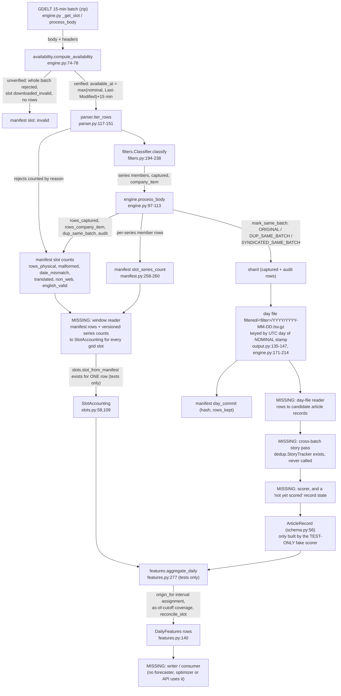

# Research Enhancement Track — Phase B2-S2.4: Read-Only GDELT Sentiment Integration Audit

**Status: READ-ONLY AUDIT. Nothing was implemented, changed, downloaded, installed, scored or approved.** Date: 2026-10-20 (UTC).
Written for: the project owner, to decide the smallest next implementation phase.

**Labels.** **[MEASURED]** a number observed in a local artifact by a read-only run in this phase. **[CODE]** derived by reading
the repository (path and line given). **[PROPOSED]** a recommendation or interface that does not exist yet. **[UNVERIFIED]**
evidence insufficient. **[BLOCKED]** needs an owner decision or a missing producer. Contract rows use `VERIFIED / PROPOSED /
UNVERIFIED / BLOCKED` as required; `VERIFIED` means [CODE] or [MEASURED] in this phase. Assumptions are called out as such.
Nothing here claims external validation.

---

## 1. Executive summary

1. **The pieces that exist line up exactly on the real sample.** On all 192 batches of the local B2-M sample [MEASURED]: one
   canonical batch id (`batch_ts`) is shared by the manifest, day files, record ids and the S2.3 types, with no unmatched,
   duplicate or inconsistent identifier; manifest `rows_captured` equals the kept day-file rows; per-theme series counts equal the
   per-theme flagged rows; the day-file availability time equals the manifest's; the 170 day-file hashes re-compute to the
   committed values; and the S2.3 reconciliation digest is identical across runs.
2. **But nothing connects them yet.** No code reads the manifest into `SlotAccounting` for a window, no code reads the day files
   into article records, no producer creates `story_id` or cross-batch duplicate statuses, nothing scores, and nothing consumes
   `DailyFeatures` [CODE, grep]. `slot_from_manifest` and `reconcile_slot` are used only by the tests; the aggregator has no
   non-test caller. The prompt's `IntervalSlot` no longer exists: S2.3 replaced it by `SlotAccounting`.
3. **The real sample cannot exercise the aggregator end to end** [MEASURED]: it holds 0 complete UTC days (192 isolated batches
   over 170 days), so no interval grid is complete. End-to-end checks need synthetic fixtures; the sample can validate adapters
   and per-batch reconciliation only.
4. **Newly found integration gaps** (section 6): there is no "scored later" article state (`ArticleRecord` requires model fields,
   and `unavailable` demands a reason); `slot_series_count` is keyed by filter version but the adapter takes an unchecked
   mapping; the day-file title is post-processed so `title_sha256` and the filter's `title_hash` differ for all but 45 of 26,854
   rows; the manifest does not store the empty/CRLF line counts needed to prove the physical-line identity in general; and cross-batch
   repeats do exist in the sample (37 URLs and 144 title hashes appear in two or more batches) so the missing dedup pass matters.
5. **Recommendation.** The smallest safe next phase is a read-only, no-scoring adapter pair (manifest to `SlotAccounting`; day
   files to candidate records) tested with synthetic fixtures plus the read-only sample (section 9). Dedup, calendar and coverage
   decisions are not needed for that phase but are needed before any feature is trusted.

## 2. Verified repository and Git state

| Item | Result |
| --- | --- |
| HEAD / staged | `71b363f` / 0 [MEASURED] |
| Tracked modifications | 49, the same count as reported before this phase; `docs/MEMORY.md` is among them (its S2.3 entry is at line 347) [MEASURED] |
| Untracked entries | 52 before this report (51 + the S2.3 report and `slots.py` accounted for), 53 with it [MEASURED] |
| Reports present | `phaseB2S3_sentiment_design_feasibility.md`, `phaseB2S2_3_contract_correction.md`, B2-F, B2-G, B2-H, B2-M all present |
| Reports absent | The S1 audit, the S2.1 review and the S2.2 completion report do not exist as files; they were not reconstructed |
| Sentiment tests | `pytest tests/backend/data/gdelt/test_sentiment_scaffold.py -q -p no:cacheprovider -W ignore` gave **110 passed** [MEASURED]. No other test was run |
| Sample tree | 546 files; a (path, size, mtime) hash taken before and after all probes is identical [MEASURED] |
| Build state | Unchanged; the tests assert the adapter registry and the AI lock |

Caveat on "no timestamp changes": file contents and modification times were verified unchanged. Last-access times were not
inspected; the operating system's policy for them was not changed or tested.

## 3. Data-flow diagram (verified components only; missing parts are marked)

## 4. Producer / consumer table

| # | Transition | Producer (path:line) | Consumer | Schema / key fields | Timestamp semantics | Validation | Status |
| --- | --- | --- | --- | --- | --- | --- | --- |
| 1 | Acquisition, availability | `engine.py:259-361` (`_head_slot`, `_get_slot`), `availability.py:121-128` | `process_body` | `batch_ts` (14 digits, grid), headers | nominal stamp; `available_at = max(nominal, verified Last-Modified) + 15 min`; unverified rejects the whole batch (`engine.py:77-78,356-360`) | fail-closed availability rules | EXISTS |
| 2 | Manifest | `manifest.py:233-260`; `manifest_schema.sql:49-127,159-188` | adapter (missing), commit logic | `slot.batch_ts` PRIMARY KEY (`:50`); `slot_series_count` PK (`batch_ts, filter_version, series`, `:166`); `day_commit` PK (`utc_day, filter_version, parser_version`, `:186`) | `available_at_utc` ISO `Z`, whole seconds; null unless verified (`:120-121`) | CHECK constraints tie `present_verified` to verified availability (`:113-114`) and `committed` to `parsed_validated` (`:124-125`) | EXISTS |
| 3 | Parse and reject | `parser.py:117-151` | `process_body` | `GkgRow`: `record_id`, `seq`, `batch_stamp`, tone, themes, title | record id prefix must equal the batch stamp (`:136`) | counts per reject class; CRC at member end | EXISTS |
| 4 | Filter | `filters.py:194-238` | `process_body` | `members{EQUITY_US,RATES_US,GOLD}`, `captured`, `company_item` | none | candidate filter (`status: candidate_for_labelled_review`) | EXISTS (unvalidated filter) |
| 5 | Same-batch dedup | `dedup.mark_same_batch` (`dedup.py:52-67`), called `engine.py:115-118` | shard `mech_dup` column | three of six statuses | batch-local | over all English rows, but only kept rows are stored | EXISTS (partial) |
| 6 | Cross-batch dedup | `dedup.StoryTracker`, `deduplicate` (`dedup.py:70-113`) | none: used only in `tests/backend/data/gdelt/test_filters_dedup.py` | `story_id`, `reobservation_of`, `update_of` | availability order | causal | **MISSING producer** |
| 7 | Day files | `output.py:135-147`, `engine.py:171-214` | no non-test reader | 39 columns (`output.py:21-28`), header row, then `captured` rows ordered by sequence | file keyed by the UTC day of the nominal stamp (`engine.py:120`) | `day_commit.file_sha256`, `rows_kept` | EXISTS (no reader) |
| 8 | Manifest to `SlotAccounting` | `slots.slot_from_manifest` (`slots.py:109`) | tests only | one manifest row plus a series mapping | `available_at_utc` parsed strictly | raises on any missing or inconsistent input | EXISTS for one row; **window reader MISSING** |
| 9 | Day file to records | none | none | needs `gkg_record_id`, `batch_ts`, `available_at_utc`, `source_domain`, `page_title`, `member_*`, `mech_dup` | n/a | n/a | **MISSING** |
| 10 | Records to `ArticleRecord` | `fake_scorer.FakeScorerTestOnly.score` (synthetic only) | `aggregate_daily` | 20 fields, `s2_article_v2` (`schema.py:56`) | whole-second availability; scored not before available | strict | **MISSING for real data** |
| 11 | Aggregator | `features.aggregate_daily` (`features.py:277`) | tests only | `SlotAccounting`, `ArticleRecord`, calendar, `SentimentConfig` | `origin_for` for slots and articles (`features.py:320`) | grid, reconciliation, provenance, versions | EXISTS (no real input) |
| 12 | Feature rows | `DailyFeatures` (`features.py:140`), `s2_daily_v3` | none (grep: no non-test, non-report reference) | `(origin_date, theme)` | `feature_cutoff_utc` | `rules_status = PROPOSED_NOT_APPROVED` | EXISTS (no consumer, no writer) |

## 5. Proposed integration contract

`IntervalSlot` is not used anywhere; the slot input is `SlotAccounting`.

| # | Contract item | Statement | Class |
| --- | --- | --- | --- |
| C1 | Batch identity | `batch_ts` is the 14-digit nominal stamp. It is the manifest primary key, the record-id prefix (`parser.py:136`), a day-file column, `SlotAccounting.batch_ts` and `ArticleRecord.batch_ts`. Unique per slot | VERIFIED (0 mismatches on 192 batches) |
| C2 | Record identity | `gkg_record_id = <batch_ts>-<seq>` is unique across all day files and becomes `article_id` | VERIFIED on the sample (0 duplicates of 26,854); across a full window UNVERIFIED |
| C3 | Theme identity | `EQUITY_US/RATES_US/GOLD` in the manifest and in `member_equity_us/...` flags; lower-cased to `equity_us/rates_us/gold` | VERIFIED (fixed by a test) |
| C4 | Manifest to `SlotAccounting` | state from the manifest's own `slot_state`; counts only for `processed`; versions carried | VERIFIED for one row; the window mapping is PROPOSED |
| C5 | Series-count selection | series rows must be read for the slot's own `filter_version` (the table allows several versions per batch) | PROPOSED (today a plain mapping, unchecked) |
| C6 | Day file to records | read only `filtered/` files whose `day_commit.status = 'committed'` and versions match; verify header, hash, `rows_kept`; reject any row whose id prefix, UTC day or versions disagree | PROPOSED |
| C7 | Reconciliation stages | compare `rows_captured` with the kept rows, and series rows with flagged rows. Never compare `rows_english_valid`, `rows_dup_same_batch` or rejected counts with record counts | VERIFIED (measured equal and unequal respectively) |
| C8 | Nominal versus availability | the slot is accounted in the interval of its nominal time; its records enter the interval holding their availability time; one availability per batch | VERIFIED in code and synthetic tests; real late data UNVERIFIED (0 of 192 late) |
| C9 | Delayed batch | not covered at its nominal cutoff, counted as delayed, records carried into the later interval, `no_news` unknown for rows it carries | VERIFIED (S2.3 tests); strictness of the rule is BLOCKED (owner decision) |
| C10 | Incomplete, missing, duplicated, inconsistent | non-final state, missing or extra slot, count mismatch, duplicate id, mixed versions: interval unavailable with a reason, never repaired | VERIFIED |
| C11 | A grid slot with no manifest row | treat as non-final (`unverified`) so the interval is `incomplete_source_accounting` | PROPOSED (a full-window run does not exist to define it) |
| C12 | Story identifiers | a future producer would add `story_id` and a cross-batch `dup_status` per record via `StoryTracker` in availability order, with a documented warm-up; `story_id` of an `ORIGINAL` is its own record id | PROPOSED; policy BLOCKED |
| C13 | Pre-score record state | a record that has not been scored needs its own representation; `ArticleRecord` cannot hold it without a model id and a reason | BLOCKED (schema decision) |
| C14 | Feature output keys | `(origin_date, theme)`; columns of `DailyFeatures`; `model_revision`, `schema_version = s2_daily_v3`, `rules_status` on every row | VERIFIED |
| C15 | Model provenance | every record carries `model_id`, `model_revision`, `scorer_code_sha256`; the config fixes the expected triple; any difference fails | VERIFIED (synthetic) |
| C16 | Unavailable-state semantics | all non-`ok` statuses give `None` features plus a reason; `no_news` is `True` only for an `ok` interval with no candidate rows and no delayed or duplicate-only evidence | VERIFIED |
| C17 | Title hash | `title_sha256` (raw day-file title) and the filter's `title_hash` (normalised) are different keys and must be named separately | VERIFIED (equal in 45 of 26,854 rows) |

## 6. Read-only feasibility checks (all on the local sample; counts and hashes only)

Probe script (outside the project): `s24_audit.py` in the session scratchpad. It read the manifest with `mode=ro&immutable=1` and
the day files; no titles, URLs or labels were printed; nothing was written to the repository.

| Check | Result [MEASURED] |
| --- | --- |
| Manifest | 192 slots, all `present_verified`, `committed`, availability `verified`, `late_flag = 0`, `near_empty_flag = NULL`; 576 series rows = 3 per batch, all `gdelt_filter_v1`; `new_stories` non-null in 0; 170 `day_commit` rows all `committed` |
| Day files vs commit | 170 files; sha256 mismatches 0; header equals `output.COLUMNS` in 170; `rows_kept` mismatches 0; 26,854 rows; 0 rows in a file of another UTC day; slots present + absent + failed = expected in every commit |
| Identifier integrity | batches with rows 192; kept batches missing from the manifest 0; not `present_verified` 0; `present_verified` batches with no rows 0; duplicate record ids 0; id prefix differs from `batch_ts` 0; all row kinds `captured`; sequence part numeric |
| Count reconciliation per batch | `rows_captured` equals kept rows 192/192; day-file availability equals manifest 192/192; filter and parser versions equal 192/192; per-theme flagged rows equal series rows 192/192; `rows_company_item` equals flagged company rows 192/192 |
| Counts that must NOT be compared | `rows_dup_same_batch` equals kept non-ORIGINAL rows 0/192 (44,209 across all English rows versus 4,816 kept); `rows_english_valid` equals `rows_captured` 0/192 |
| Physical-line identity | `physical - (english_valid + malformed + date_mismatch + translated + non_web)` is 0 in every batch. The manifest does not store empty or CRLF line counts, so the identity is not provable in general |
| Audit rows | 203 rows in the audit files equal the manifest total; they sit in a separate directory, not in `filtered/` |
| Article fields | `schema.classify_title(min_chars=20)` on the stored titles: 26,599 ok, 206 short, 37 empty, 12 malformed. Raw-title sha256 equals the day-file `title_hash` in 45 of 26,854; 255 rows have an empty `title_hash` (the same count as non-ok titles, not proven row by row). `mech_dup`: ORIGINAL 22,038, SYNDICATED_SAME_BATCH 4,555, DUP_SAME_BATCH 261 |
| Adapter | `slot_from_manifest` succeeded on 192/192 with real series counts, 0 errors |
| Interval assignment | with a weekday-only calendar used purely for this diagnostic, 0 of 192 batches have a nominal interval different from the availability interval (consistent with `late_flag = 0`) |
| Repeats across batches | 37 canonical URLs and 144 title hashes occur in two or more batches; 131 batch pairs lie within 72 hours; 0 complete 96-slot days exist |
| Determinism | the per-batch reconciliation digest is identical across two runs (`a5aa49cc3b1e791c`); day-file hashes re-compute to the committed values; synthetic end-to-end determinism is covered by the S2.3 tests |
| Read-only guarantee | the sample tree snapshot (546 files; path, size, mtime) is identical before and after |

Checks not performed because they need a missing component or a decision: an end-to-end aggregator run on real data (no
complete interval), real late-batch behaviour (none in the sample), cross-batch dedup rates (no policy and no producer), scoring
(no approved model), and calendar-dependent grid sizes beyond the diagnostic above (calendars unapproved).

## 7. Answers to the ten audit questions

1. **Single canonical batch identifier? Yes** [MEASURED, CODE]. The nominal 14-digit `batch_ts` is shared by the manifest
   (primary key), record ids (prefix enforced at `parser.py:136`), day files, `SlotAccounting` and `ArticleRecord`; 0 mismatches
   in 192 batches. It identifies a nominal slot, not an availability time; availability is a separate field. A full-window
   uniqueness check is UNVERIFIED.
2. **Can `rows_captured` and per-theme counts be reconciled with actual records? Yes, at the captured and the series stage**
   [MEASURED 192/192]. Doing so requires reading the day files; no code does that today.
3. **Are rejected, filtered and English-valid counts distinct and reconcilable without mixing stages? Distinct: yes**
   (`rows_english_valid` is never equal to `rows_captured` in the sample; same-batch duplicate counts differ by stage). Reconcilable
   as an identity from physical lines to English-valid only if empty and CRLF lines are known; the manifest omits them, so it holds
   in the sample (residual 0) but is UNVERIFIED in general. Record-level reconciliation uses only `rows_captured` and series rows.
4. **Does each article keep enough provenance? Largely yes.** A day-file row carries `gkg_record_id`, `batch_ts`,
   `available_at_utc` and the filter and parser versions; the batch is recoverable and the availability equals the manifest's in 192/192.
   Missing: the source day-file path and hash as an explicit field of the future record, and `story_id`.
5. **Can a late batch be accounted in its source slot while its articles enter only intervals where available? Yes in the
   implemented logic** (S2.3 synthetic tests, `features.py:225-250,320-345`). In the data, availability is one value per batch and
   is identical in the manifest and every row, which makes the rule sound. No real late batch exists in the sample, so real-data
   behaviour is UNVERIFIED. The strictness of the rule is BLOCKED.
6. **Can it distinguish verified no-news from missing, delayed, incomplete and duplicates-only data? Yes** (distinct statuses and
   `no_news` values, `features.py:225-250,361-420`), tested synthetically. It cannot yet do so for real data because no producer
   feeds it.
7. **What is missing between manifest/day files and `SlotAccounting`?** (a) A window reader that, for every nominal grid slot,
   builds a `SlotAccounting` from the manifest row (or treats a missing row as non-final, C11), selecting series counts by the slot's
   filter version and only from committed day versions (C5, C6); (b) a day-file reader that verifies the file hash, header and
   row identifiers and yields candidate records (C6); (c) a record type for "not yet scored" (C13); (d) the cross-batch story pass
   (C12); (e) the orchestration of calendar, config and writing of features. `IntervalSlot` no longer exists.
8. **Which unresolved decisions affect integration correctness?** The dedup and story-update policy (what `dup_status` and
   `story_id` mean and which rows are fed); the holiday and early-close calendars (they set cutoffs and expected grid sizes: a
   wrong calendar produces `slot_grid_mismatch`); the coverage threshold and near-empty treatment (they decide which intervals are
   `ok`); late-batch strictness; theme-specific cutoffs. The reconciliation and identifier checks themselves need none of them.
9. **Can the integration be tested without a model, network or full-window acquisition? Yes.** Adapters can be tested with
   synthetic manifest rows (an in-memory database built from the repository's own `manifest_schema.sql` or plain dicts) and
   synthetic gzip day files under a temporary directory outside the repository, plus the read-only sample for per-batch and hash
   checks. The aggregator is already tested with the test-only fake scorer on synthetic records. Real-data end to end cannot be
   tested until a contiguous real window exists.
10. **Smallest safe next phase?** Steps 1 and 2 of section 9 (read-only adapters, no scoring, no features), proposed as S2.5.

## 8. Unresolved decisions, risks and blockers

**Decisions (BLOCKED, owner):** dedup and story-update policy; coverage threshold and near-empty treatment; holiday and
early-close calendars and theme-specific cutoffs; late-batch strictness; pre-score record representation; forecast target; model,
licence, dependency; polarity validation; full-window acquisition (no switch exists, `__init__.py:17`).

**Risks**
1. Series counts are keyed by filter version but passed to the adapter as an unchecked mapping (a mixed-version database could
   feed wrong counts). [CODE]
2. `day_commit.status` allows `superseded` but no code writes it (grep); a reader must filter `committed` and versions. [CODE]
3. Day-file titles are post-processed (`html.unescape` and strip at `parser.py:148`, tab/CR/LF replaced by spaces at
   `output.py:62-64`), so any hash of the title is of the stored text, not the original. [CODE]
4. The all-English-rows near-empty flag is NULL for the whole sample and, in a full run, depends on commit order
   (`engine.py:163-168`, `manifest.py:331-340`). [CODE]
5. Cross-batch repeats exist but are unmeasured; without the story pass the sample's 37 URLs and 144 title hashes would be counted as
   separate stories. [MEASURED]
6. `canonical_url` drops query strings (`filters.py:82-90`); false merges unmeasured. [CODE]
7. Memory and ordering of a whole-window story pass are unmeasured (S3 estimate, assumption).
8. The filter is a candidate and the B2 evaluation is incomplete; every theme count inherits that.
9. Empty/CRLF line counts are not stored, so line-level identities cannot be re-proven from the manifest alone.
10. The `origin_for` helper rebuilds its cutoff list on each call; performance at window scale is unmeasured (assumption).

## 9. Minimal implementation plan (independently testable; none started)

| Step | Scope | Tests (all offline) | Needs decision? |
| --- | --- | --- | --- |
| 1. Manifest window reader | Pure functions: for a list of grid stamps, manifest rows (dicts) and series-count rows, return `SlotAccounting` per stamp. Missing row maps to `unverified`; series rows chosen by the slot's filter version; `day_commit` committed and versions checked | Synthetic rows; an in-memory database from `manifest_schema.sql`; read-only sample: 192/192 convert | No |
| 2. Day-file reader | Read a committed day file given its `day_commit` record: verify hash, header, `rows_kept`, id prefix, UTC day, versions, uniqueness; yield candidate records (id, batch, availability, domain, title text, theme flags, same-batch status) | Synthetic gzip files in a temp directory outside the repository; read-only sample: hashes match, 26,854 rows | No |
| 3. Interval reconciliation harness | Combine 1 and 2 with the existing `reconcile_slot` across multi-day synthetic fixtures, including a late batch crossing two day files and a weekend | Synthetic only; determinism by digest | No |
| 4. Pre-score record state | Define how an unscored record is represented | Schema tests | **Yes (C13)** |
| 5. Cross-batch story pass | Run `StoryTracker` in availability order with a stated warm-up | Synthetic; compare with `test_filters_dedup.py` | **Yes (policy)** |
| 6. Feature writer | Deterministic, hashed output of `DailyFeatures` | Reproducibility | Calendar, threshold |

Steps 1 and 2 could be a single phase; neither scores, writes features, nor decides a policy.

## 10. Actions deliberately not taken

No source, test, configuration, schema, manifest, dataset, `docs/MEMORY.md` or existing report was edited. No package
installation, network access, download, model, inference, provider call or acquisition. No sealed key, annotation label,
AI-only data, `.env` or API key was read; no title or URL was printed. No change to D8, the D12/D12.1 guard, the D13 lock, provider
gates, build lock, adapter registry or compliance rules. No choice of dedup, coverage threshold, calendar, theme-specific cutoff,
target, model, licence or dependency. No staging, commit or push. No implementation and no S4. The only project file created is
this report; the probe script lives in the session scratchpad.
