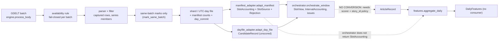

# Research Enhancement Track — Phase B2-S2.7: Read-Only Sentiment Pipeline Contract and Research-Readiness Audit

**Status: READ-ONLY AUDIT. No source code, test, dataset, manifest, day file, configuration or existing report was changed.** The only
project file created is this report. Date: 2026-10-20 (UTC). Written for: the project owner, to decide what must be fixed and decided
before a defensible sentiment experiment.

**Labels.** **VERIFIED** shown by code or by a reproducible observation in this phase. **DEFECT** the code does something that
contradicts a stated contract or the project rules (reproduced). **UNVERIFIED** not shown either way. **BLOCKED** cannot be settled
without an owner decision or a missing producer. Observations come from throw-away probes in the session scratchpad
(`s27_probe.py`, `s27_probe2.py`): synthetic in-memory worlds plus the local B2-M sample opened read-only. They are reproducible but
are not part of the repository, and no defect was fixed.

---

## 1. Verified baseline

| Item | Result |
| --- | --- |
| Git | HEAD `71b363f`; staged 0; tracked modifications 49 (the pre-existing demo work plus `docs/MEMORY.md`); untracked 55 |
| Reports | S2.3, S2.4, S2.5, S2.6 and S3 reports present. The S1, S2.1 and S2.2 reports do not exist as files and were not reconstructed |
| Tests, focused | `pytest tests/backend/data/gdelt/test_sentiment_orchestrator.py tests/backend/data/gdelt/test_sentiment_adapters.py tests/backend/data/gdelt/test_sentiment_scaffold.py -q -p no:cacheprovider -W ignore`: **162 passed** |
| Tests, orchestrator only | `pytest tests/backend/data/gdelt/test_sentiment_orchestrator.py ...`: **25 passed** |
| Tests, full suite | `pytest tests/backend/data/gdelt -q -p no:cacheprovider -W ignore`: **1187 passed** in 240 s |
| S2.6 claims | all three numbers re-confirmed (162, 25, 1,187) |
| Sample tree | 546 files, unchanged count; the probes opened the manifest `mode=ro&immutable=1` and wrote nothing |
| Production consumers | grep of every `*.py`: references to the sentiment package exist only inside the package and in the three sentiment test files |
| Not run | frontend, hosted-database and full-project suites (not needed for this audit) |

## 2. End-to-end sequence (verified components only)

Solid arrows exist and are tested. The dotted links are absent. The cross-batch story pass (`dedup.StoryTracker`) is not on the path.

## 3. Contract findings (the twelve questions)

### 3.1 Which source fields are verified at each boundary? **VERIFIED**

| Boundary | Verified (symbol) |
| --- | --- |
| Manifest to `SlotAccounting` (`manifest_adapter.adapt_manifest`, `slots.SlotAccounting`) | canonical `batch_ts` and uniqueness; `slot_state` fields; for processed: `existence`, `parse_status`, `availability_status`, whole-second `available_at_utc` of at least nominal + 15 min; ten stage counts as non-negative integers with nested-set inequalities; exactly one row for each of the three series for the requested `filter_version`; slot and series version equal; `filter_version`/`parser_version` present |
| Day file to candidates (`dayfile_adapter.adapt_day_file`) | gzip/UTF-8; header equals `output.COLUMNS`; with the commit: status, day, versions, `rows_kept`, SHA-256; per row: `captured`, id format and prefix equals `batch_ts`, batch on the file's UTC day, processed slot, availability equals the slot's, versions equal the slot's, 0/1 flags, same-batch status in the engine's three, title hash empty or SHA-256, required provenance non-empty, unique id |
| Orchestrator | calendar inputs and days; window partition; reconciliation `slots.reconcile_slot` (captured, per theme, availability); trust rules per batch |
| Aggregator (`features.aggregate_daily`) | calendar; slot grid; reconciliation; provenance triple; single filter/parser version; schema validation of every `ArticleRecord` |

### 3.2 Which invariants are enforced and which only documented?

| Invariant | Class | Evidence |
| --- | --- | --- |
| Records of an unreconciled batch are never placed | VERIFIED enforced | `orchestrator` step 4; tests; mutation check |
| A record id cannot repeat across day files | VERIFIED by construction only | P8: a 03-02 id in the 03-03 file is rejected `batch_not_in_file_day`; there is no separate window-level check, and none is needed while those two rules hold |
| `rows_company_item` equals the record company flags | **DEFECT (not enforced)** | F3 |
| Slots in a window share one parser version | **DEFECT (not enforced by the orchestrator)** | F4 |
| `min_chars` equals the filter specification's `title_hash_min_chars` | UNVERIFIED (documented; the value is a caller argument) | `dayfile_adapter.adapt_day_file` |
| Early-close and holiday lists are correct | BLOCKED (caller-supplied, unapproved) | `WindowInputs`, `SentimentConfig` |
| The first calendar day is only a lower bound | VERIFIED enforced | `features.interval_locator` |
| `availability_flags` (`late`, `rewrite_suspect`) | UNVERIFIED relevance: kept in `SlotSource`, used by nothing | `manifest_adapter.SlotSource` |

### 3.3 Can invalid, missing, non-final, delayed or unreconciled data reach a supposedly complete interval?

**Mostly no, with three reproduced exceptions.** Each of those states is turned into a non-complete status or held back (tests plus a
13-guard mutation check). The exceptions: **F1** (a late pre-window batch), **F3** (an unreconciled company count) and **F4** (mixed
parser versions). A near-empty slot also does not stop an orchestrator interval from being `accounted_complete` (F2).

### 3.4 Availability and cutoff consistency across adapters, orchestrator, aggregator? **VERIFIED**

All three use the same helpers (`session_calendar.cutoff_utc`, `origin_for` through `features.interval_locator`,
`timeutil.slot_grid`). The delayed rule is the same (`available_at > cutoff` in the orchestrator, `<= cutoff` covered in the
aggregator). Availability is validated as whole seconds at least nominal + 15 minutes in the slot and the schema; there is no upper
bound (a very late batch is simply delayed).

### 3.5 Are calendars explicit or inferred? **VERIFIED explicit**

`trading_days`, `early_closes` and `market_holidays` are caller inputs, validated (plain dates, weekdays, no gaps, no overlap). Nothing is
inferred from the manifest. The orchestrator and the aggregator take separate copies; they are not linked, but a mismatch fails closed
(P7: orchestrator with an early close, aggregator without: `slot_grid_mismatch`). Correctness of the lists is BLOCKED on approval; the
proposed early-close list ends in 2025.

### 3.6 Are missing records distinguished from verified zero-record intervals? **VERIFIED in the orchestrator, with caveats**

`verified_complete_no_records` requires every slot reconciled and none delayed; every other empty interval is one of three
`unverified_empty_*` bases. Caveats: F1 (a hidden late batch produces a false `verified_complete_no_records`), F2 (the aggregator's
`no_news` rule differs), and near-empty slots are ignored by the orchestrator.

### 3.7 Repeated URLs and title hashes preserved without story identity? **VERIFIED**

Records are never removed; repeats are only counted (`RepeatedContent`); `CandidateRecord` has no `story_id` and no cross-batch status.
Risk at the next boundary: F9.

### 3.8 Duplicate ids rejected consistently, individually and window-wide? **VERIFIED**

Within a file: every copy is rejected and the batch becomes `duplicate_record_id`. Across files: impossible by the id-prefix and
file-day rules (P8).

### 3.9 Records outside the requested window handled consistently? **PARTLY (defects F1, F5)**

Manifest rows of batches outside the nominal grid are counted and ignored; records of such batches are counted as out of window.
That is consistent, but ignoring the manifest rows hides the case in which an outside batch becomes available inside the window (F1),
and the out-of-window counter can include a malformed record (F5).

### 3.10 Does `policy_status` block downstream use? **DEFECT (informational only)**

It is a plain dict on a frozen dataclass: nothing reads it, and it can be mutated (P4: assignment succeeded). `DailyFeatures.rules_status`
is a string. No code path refuses a result because a policy is unresolved. Blocking today is by absence of a conversion step, not by
a check.

### 3.11 Can any API or production path consume these outputs accidentally? **VERIFIED not today; not enforced against tomorrow**

No non-test code imports the package; an isolation test scans `backend/`, `training/`, `scripts/` and `tests/`. This is a test and a
convention, not a runtime barrier (the fake scorer additionally refuses to run outside pytest).

### 3.12 Are all returned counts and states traceable to verified source records? **VERIFIED mostly**

Records carry `source_file`, `source_line`, batch and id; issues carry batch, line and id; `DayFileStatus` carries the file hash.
Gaps: no identity for the manifest input (no hash of the slot or series rows), no run-level code or specification fingerprint in the
report, and `WindowReport.digest()` covers states and ids but not record content or `policy_status`. UNVERIFIED reproducibility of
the manifest input.

## 4. Defects found (reproduced; not fixed)

| ID | Sev. | Finding | Where | Reproduction |
| --- | --- | --- | --- | --- |
| F1 | High | A batch whose nominal slot is before the first interval but whose verified availability lies inside the window is ignored (counted as an outside manifest row). The interval it belongs to stays `accounted_complete` and its themes `verified_complete_no_records` although a real record exists at the cutoff | `orchestrator.orchestrate_window`, window partition step | P1: a processed pre-window batch with one equity record, available 05:00Z inside D2: D2 `accounted_complete`, `verified_complete_no_records`, 0 records, `n_manifest_rows_outside_window = 1`, no issue |
| F2 | High | Orchestrator and aggregator give different answers on identical inputs, and the aggregator's `no_news = True` is available where the orchestrator withholds a verdict | `orchestrator` empty-interval rules versus `features._assess_day` / `_theme_row` | P6b (with `near_empty_flag = 0`): one delayed empty batch, orchestrator `unverified_empty_delayed`, aggregator `ok`, `no_news = True`; one absent batch, orchestrator `unverified_empty_partial`, aggregator `ok`, `no_news = True`; a quarter-day of near-empty slots, orchestrator `accounted_complete`, aggregator `insufficient_coverage` |
| F2b | High | With `near_empty_flag` NULL (all 192 sample batches, and the first baseline days of any window) the aggregator marks every interval `insufficient_coverage`; the orchestrator ignores near-empty entirely | `coverage.interval_count`, `features._assess_day`; `orchestrator` | P6: all reconciled slots, flag NULL: orchestrator `accounted_complete`, aggregator `insufficient_coverage`, `no_news = None` |
| F3 | Medium | `rows_company_item` (a same-stage count that matched 192/192 in S2.4) is kept as provenance but never reconciled with the records' company flags | `manifest_adapter.SlotSource`, `slots.reconcile_slot` | P2: manifest says 1 company item, the record is not one: slot `reconciled`, interval `accounted_complete` |
| F4 | Medium | The orchestrator does not require one parser version across the window (the filter version is pinned by argument); the aggregator refuses a mixed set | `orchestrator`; `features.aggregate_daily` | P5: day 03-03 produced by `gkg_parser_v2`: orchestrator reports both intervals `accounted_complete`; the aggregator raises "different filter/parser versions" |
| F5 | Low | A record with an invalid `batch_ts` is also counted in `n_out_of_window_records` (its orphan rejection has no batch, which the orchestrator reads as "outside the grid"); the invalid-batch issue is still reported and the slot becomes `count_mismatch` | `orchestrator`, orphan-code branch | P3: `oow = 1`, issues `invalid_batch_ts`, `record_id_batch_mismatch` |
| F6 | Low | `policy_status` is a mutable dict on a frozen dataclass and nothing enforces it | `orchestrator.WindowReport` | P4 |
| F7 | Low | `WindowReport.digest()` omits record content, titles' hashes and `policy_status`, so it identifies states, not content | `orchestrator.WindowReport.digest` | reading |

## 5. Aggregator-boundary findings

Can the aggregator safely consume orchestrator output? **No, and not only because no converter exists.**

1. **Field map (`CandidateRecord` to `ArticleRecord`).** Supplied by the candidate: `article_id`, `batch_ts`, `available_at_utc`
   (status verified), `source_domain`, `title_sha256` (raw hash), `text_status`, `theme_flags`, and a `dup_status` limited to
   `ORIGINAL`/`DUP_SAME_BATCH`/`SYNDICATED_SAME_BATCH` (a valid subset of the six). **No source** for: `story_id`, `model_id`,
   `model_revision`, the three probabilities, `pred_label`, `unavailable_reason` (for unscored text that is ok there is no state that
   is not `scorer_failure`), `scored_at_utc`, `scorer_code_sha256` (P10). The scorer fields are BLOCKED on a model decision.
2. **`story_id` [BLOCKED].** Any value would assert an identity: the record id asserts "every record is its own story"; a URL or
   hash asserts "equal content is one story". Neither is verified. The aggregator treats several non-UPDATE records with one
   `story_id` as unresolved, so the choice changes results.
3. **Double counting [BLOCKED, quantified].** Cross-batch repeats receive `ORIGINAL` (only same-batch marks exist), so the proposed
   rule would count each as a separate eligible record. In the 192-batch sample, 261 of 22,038 `ORIGINAL` records (1.2%) repeat an
   earlier batch's URL (68) or title hash (215); the sample is isolated batches, so this is a lower bound.
4. **Slot accounting.** The orchestrator exposes `SlotView`, not `SlotAccounting`, so its output cannot be passed to
   `aggregate_daily` without re-adapting; the two pipelines then run their own reconciliation twice (F2).
5. **Empty, near-empty and delayed intervals.** Three different rules: the orchestrator (strict, no near-empty), the aggregator
   (threshold-based, near-empty not covered), the S3 design (point-in-time). They must be reconciled by one decision (section 6, items 3, 5, 8).
6. **Unavailable versus zero versus no-news.** Preserved inside the aggregator (None, real zero via `n_eligible = 0`, `no_news`
   True/False/None) and by the orchestrator bases; the two vocabularies are not mapped to each other.
7. **Theme-specific coverage.** Series rows exist per theme but coverage and near-empty are interval-level; a theme such as gold
   (about one member row per batch in the sample) cannot be judged separately.
8. **Calendar and cutoffs.** Consistent when the same lists are passed (VERIFIED); two independent copies; a mismatch fails closed (P7).
9. **Provenance.** The aggregator would need a `story_id`, a model identity and a scoring time; none exists.

**Exact blocker:** converting unscored candidates into scored articles requires (a) an approved scorer with pinned identity,
(b) a decision on `story_id` and cross-batch duplicate labelling, (c) a decision on how an unscored record is represented if it must pass
through the schema, and (d) agreement between the orchestrator's and the aggregator's empty-interval rules. No conversion was invented.

## 6. Research decisions register

Owner for every row: **the project owner**. "Blocks" lists the first stage that cannot proceed: S = synthetic testing, R = real-data
processing, F = feature generation, E = model evaluation. Nothing below is approved, including the 0.75 threshold.

| # | Decision | Why it matters | Options supported by the repository | Consequences | Blocks |
| --- | --- | --- | --- | --- | --- |
| 1 | Deduplication and story updates | defines what a record, a story and a count are | P0 none; P1 story once at first availability (B2-H primary); P2 latest version; P3 keep versions (S2 proposal); P4 story once plus separate intensity features (S3 §3.2.2) | P0 inflates by about 21% same-batch plus cross-batch; P1/P2 need the causal story pass and a warm-up; B2-H and S2 proposals disagree on updates | F, E |
| 2 | Story identity across intervals | repeated stories re-enter later intervals | first-occurrence only; per-interval counting; weight by repeats | changes counts and leakage risk; needs the story pass | F, E |
| 3 | Source coverage threshold | decides which intervals are usable | 0.75 (proposed), 0.5 and 0.9 (sensitivity), none | too high drops intervals, too low admits thin ones | F |
| 4 | Scoring-coverage threshold | partial scoring can mislead | report-only (current); fixed fraction; minimum count | affects which days carry a mean | F |
| 5 | Near-empty slots | currently uncovered, and NULL until 7 baseline days | keep uncovered; count as covered; exclude from the denominator; 10% / 14 days / 7 observations as proposed | quiet days vanish non-randomly; NULL flags make every aggregator interval `insufficient_coverage` (F2b) | R, F |
| 6 | Holiday and early-close calendars | set cutoffs and grid sizes | stored market dates (B2-H); the proposed early-close list (ends 2025) | a wrong calendar is `slot_grid_mismatch` or a wrong cutoff | R, F |
| 7 | Theme-specific cutoffs | rates and gold close at other times | single equity-session cutoff (current) | simplicity versus fidelity | F, E |
| 8 | Late-batch strictness and pre-window lookback | what a late or pre-window batch does to an interval | minimum point-in-time (current); interval unavailable if any batch late; require an earlier trading day | F1 is a hole until decided; stricter loses intervals | R, F |
| 9 | Model, licence, dependency route | no scorer exists | FinBERT-class, lexicon, GDELT tone fields, LLM (blocked) (S3 §3.4) | licence, isolation, domain mismatch | scoring, F, E |
| 10 | Polarity validation | no ground truth for sentiment exists | Financial PhraseBank (non-commercial licence), human-labelled hindsight-free sample | without it a sentiment feature is unvalidated | E |
| 11 | Experiment target | defines labels, embargo, metrics | T1 to T5; T3 proposed (S3 §3.6.2) | sample size and detectable effect | E |
| 12 | Full-window acquisition | all real-data steps need a contiguous window | none enabled; a separate gated phase | 0.86 TB, about 321,000 requests | R |
| 13 | Filter validity gate | series membership is an unvalidated candidate | block sentiment work until the B2 evaluation passes; allow exploratory use labelled as such | inherits `INSUFFICIENT_EVIDENCE` | E |
| 14 | Pre-score record and `story_id` placeholder | the next conversion step | new schema state; a placeholder policy | changes an approved contract | F |
| 15 | Contract hardening (F1, F3, F4, F5, F6) | closes the reproduced defects | a small corrective phase | no research choice involved except the F1 option in row 8 | R |

Row 13 evidence: `metric_status.py` states that without valid independent labels no accuracy metric is available and the decision is
`INSUFFICIENT_EVIDENCE`; nothing in the sentiment package references the decision or the filter state (grep: no `decision`,
`metric_status` or specification reference).

## 7. Research-readiness verdicts

| Area | Verdict | Evidence |
| --- | --- | --- |
| Source ingestion | **CONDITIONAL** | Acquisition, parsing, manifest and day files are verified on the 192-batch sample (0 rejections, hashes match). Full-window acquisition has no switch and no approval; the filter is a candidate; cross-batch story state is not produced; late behaviour is untested on real data |
| Source accounting and orchestration | **CONDITIONAL** (GO for synthetic orchestration only) | 25 integration tests and a 13-guard mutation check; fail-closed on missing, non-final, delayed and unreconciled input. Not GO for real data because of F1, F3, F4 and F2/F2b, an unapproved calendar, and no complete real interval to test |
| Scoring | **NO-GO** | no model, licence, dependency or validation; no pre-score representation; no `story_id` policy |
| Feature generation | **NO-GO** | needs scoring, a dedup and story policy, coverage and near-empty rules, an agreed empty-interval rule (F2), and a baseline (F2b); the aggregator cannot consume the orchestrator output |
| Experimental evaluation | **NO-GO** | target unapproved; filter unvalidated; no polarity validation; no full window; effective sample small |
| Production | **NO-GO** | research track; isolated by convention only; `policy_status` informational; no ADR, no API, no approval |

A GO for synthetic orchestration is not a GO for real sentiment research.

## 8. Recommended next step and stop conditions

**Smallest step with the most effect:** a **decision sheet** (no code) for rows 3, 5, 8 and 1/2, because they decide what a correct
corrective phase would enforce and remove the F2/F2b disagreement. Then, as a separate approved phase, a **small corrective phase** for
F1, F3, F4, F5 and F6 using synthetic contract tests (the reproductions above are the failing tests): scan outside-window manifest rows
for availability inside the window, reconcile `rows_company_item`, pin one parser version, fix the out-of-window counter, freeze
`policy_status`.

**Stop conditions:** do not build the candidate-to-`ArticleRecord` conversion, a story-id placeholder, a scorer, a feature run, a
file-backed reader or any acquisition until the corresponding row in section 6 is decided. Do not treat the orchestrator's or the
aggregator's `no_news` as evidence until F2 is settled.

## 9. Tests run

| Command | Result |
| --- | --- |
| `.venv/Scripts/python.exe -m pytest tests/backend/data/gdelt/test_sentiment_orchestrator.py tests/backend/data/gdelt/test_sentiment_adapters.py tests/backend/data/gdelt/test_sentiment_scaffold.py -q -p no:cacheprovider -W ignore` | 162 passed |
| `.venv/Scripts/python.exe -m pytest tests/backend/data/gdelt/test_sentiment_orchestrator.py -q -p no:cacheprovider -W ignore` | 25 passed |
| `.venv/Scripts/python.exe -m pytest tests/backend/data/gdelt -q -p no:cacheprovider -W ignore` | 1187 passed |
| scratchpad probes `s27_probe.py`, `s27_probe2.py` | outputs quoted above; not part of the suite |

## 10. Confirmation

No code, tests, datasets, manifests or day files were changed (the sample tree still has 546 files; the manifest was opened read-only and
immutable; the probes ran in memory). No network, installation, model, inference, provider call, acquisition or database change. No
sealed key, annotation label or AI-only data was read (`metric_status.py` was read for its documented purpose only and was not run).
D8 criteria, the D12/D12.1 guard, the D13 lock, provider gates, compliance rules, build lock and adapter registry are untouched. No
staging, commit or push. Final Git state: HEAD `71b363f`, staged 0, tracked modifications 49 (unchanged), untracked 55 before this
report and 56 with it. Stopped after S2.7; S2.8 and S4 were not started.
